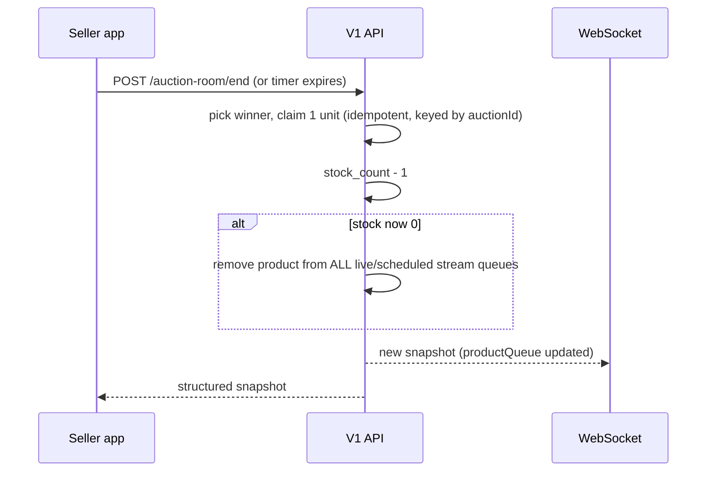

# Managed Store Stock (Scan → Sell → Sold Out) — Flutter Integration Guide

**Audience:** Flutter engineers building the **Seller** mobile app (managed sellers)
**Auth:** `Authorization: Bearer <cognito_access_token>`
**Envelope:** Success `{ "success": true, "data": ..., "meta": {} }` · Error `{ "success": false, "error": { "code", "message" } }`
**Branch on `error.code`, never on HTTP status alone and never on `error.message` text.**

**Related docs (read first if you have not):**
- Endpoint reference for scanning: [MOBILE_SELLER_PRODUCT_REQUEST_API_FLOW.md](./MOBILE_SELLER_PRODUCT_REQUEST_API_FLOW.md)
- Auction room endpoints, sessions, realtime: [MOBILE_SELLER_AUCTION_ROOM_V1_INTEGRATION_GUIDE.md](./MOBILE_SELLER_AUCTION_ROOM_V1_INTEGRATION_GUIDE.md) and [FLUTTER_SELLER_STREAM_SESSION_GUIDE.md](./FLUTTER_SELLER_STREAM_SESSION_GUIDE.md)
- Defect photos on a scanned line: [FLUTTER_PRODUCT_DEFECTS_GUIDE.md](./FLUTTER_PRODUCT_DEFECTS_GUIDE.md)

This guide explains **how the stock quantity of a store product behaves end to end** and which APIs the app calls at each step. You do not need backend source, only these contracts.

**Scope:** admin-managed store products and **managed** sellers. Independent sellers and stream-random ("Tilfeldig") products do **not** use this model (random products keep their own `randomStock`).

---

## 1. The one rule

> `products.stock_count` is **the** sellable quantity of a managed product. It is shared by every stream, auction, offer and buy-now. There is no per-seller or per-stream stock any more.

| Event | Effect on stock | Who triggers it |
|-------|-----------------|-----------------|
| Seller scans a product (`/scan`) | **No change yet.** The scan only adds/increments a *draft* line. | Seller app |
| Seller **submits** the request (`PATCH … { "action": "submit" }`) | **Stock increases** by the scanned quantity, exactly once per unit. | Seller app |
| Auction ends with a winner (winner is charged) | **Stock decreases by 1** | Server (automatic) |
| Offer is accepted | Stock decreases (one claim per accepted offer) | Server (automatic) |
| Buy-now order is placed | Stock decreases | Server (automatic) |
| Sale is cancelled / unpaid order expires | The unit is **returned** (once) | Server (automatic) |
| Stock reaches **0** | Product is removed from buyer listings and from every live/scheduled stream queue. Detail page stays and shows "sold out". | Server (automatic) |
| Seller scans and submits more of a sold-out product | Stock goes up again and the product is sellable again | Seller app |

**The app never sends a stock number.** It only scans and submits; all stock arithmetic is server-side, atomic and idempotent. The app only **displays** `stockCount`.

### Worked example

1. Stock is `0`. Seller scans UPC `X` five times (line quantity `5`) → stock still `0`.
2. Seller submits → stock `5`.
3. Seller scans `X` twice more and submits again → stock `7` (only the +2 is added, never the full `7` again).
4. Auction for `X` is won → stock `6`. An offer for `X` is accepted → stock `5`.
5. Retrying submit, retrying payment or re-running settlement never changes the number a second time.
6. When stock hits `0`, `X` disappears from queues; one more confirmed scan reopens it.

---

## 2. Part A — Product request: scanning increases stock

### 2.1 Call order

```text
GET   /api/v1/seller/streams?page=1&pageSize=20
GET   /api/v1/seller/streams/{streamId}/product-requests          // 0 or 1 item
POST  /api/v1/seller/streams/{streamId}/product-requests          // only when 0 items (body {})
POST  /api/v1/seller/streams/{streamId}/product-requests/scan     // { "upc": "..." } repeat per scan
  └─ 404 PRODUCT_NOT_FOUND_IN_CATALOG →
POST  /api/v1/seller/streams/{streamId}/product-requests/scan/unknown
GET   /api/v1/seller/streams/{streamId}/product-requests/{requestId}   // review
DELETE /api/v1/seller/streams/{streamId}/product-requests/items/{itemId}   // optional: remove a line
PATCH /api/v1/seller/streams/{streamId}/product-requests/{requestId}   // { "action": "submit" }  ← stock is added HERE
```

Full request/response bodies for each endpoint are in [MOBILE_SELLER_PRODUCT_REQUEST_API_FLOW.md](./MOBILE_SELLER_PRODUCT_REQUEST_API_FLOW.md). The parts that matter for stock:

### 2.2 Scan — `POST …/product-requests/scan`

Body `{ "upc": "012345678905" }`. Success `data`:

```json
{
  "action": "created",
  "requestId": "req-uuid",
  "quantity": 3,
  "item": {
    "id": "line-uuid",
    "productId": "prod-id",
    "quantityRequested": 3,
    "lineStatus": "DRAFT",
    "product": { "id": "prod-id", "name": "Blue jacket", "stockCount": 4, "thumbnailUrl": "https://…" }
  }
}
```

- `action` is `created` (first scan of this product) or `incremented` (same product scanned again). Use it for toast copy.
- `item.quantityRequested` / `quantity` is the **number of units the seller is registering**, not the stock.
- `item.product.stockCount` is the **current shared stock before this scan is submitted**. Show it as "In stock now: N". It does **not** include the draft quantity.
- Catalog miss: `404` with `error.code === "PRODUCT_NOT_FOUND_IN_CATALOG"` → open the unknown-product capture sheet and call `/scan/unknown` (see the product-request doc). Unknown lines **never add stock**; an admin must link them to a catalog product first (then the seller's scanned quantity is credited once).

> A seller can keep scanning after a submit (the same request gets new draft lines or increments). Submit again and only the **new** units are added.

### 2.3 Submit — `PATCH …/product-requests/{requestId}` `{ "action": "submit" }`

What the server does in **one transaction**:

1. For every known catalog line: adds `quantityRequested − alreadyCredited` to `products.stock_count`.
2. Marks those lines `RESERVED` (`reservedQuantity = quantityRequested`, `pendingQuantity = 0`).
3. Marks unknown-UPC lines `PENDING_UNKNOWN` (no stock added).
4. Sets the request `status = "SUBMITTED"`.
5. Queues the known products into the stream's auction queue (best effort).

Response `data` is the refreshed request detail. Read `items[].product.stockCount` to show the **new** stock per line ("Stock is now N").

Rules for the UI:
- Disable the Submit button while the call is in flight; a retry is safe (nothing is added twice) but there is no reason to allow it.
- `400 BAD_REQUEST` "Add at least one product" → request has no lines.
- `400 BAD_REQUEST` "Request is cancelled" → request was cancelled.
- Do **not** compute stock locally after submit. Re-read `stockCount` from the response.

### 2.4 Line status after submit (`lineStatus`)

| `lineStatus` | Meaning now |
|--------------|-------------|
| `DRAFT` | Scanned, not yet submitted. No stock added. |
| `RESERVED` | Submitted and **credited to stock**. (Name is historical: it means "confirmed", the units are now in shared stock.) |
| `PENDING_UNKNOWN` | Unknown UPC waiting for an admin to match a catalog product. No stock yet. |
| `PENDING_STOCK` | **Legacy only.** No longer produced. Render it as a neutral "pending" badge if you ever receive it (old rows). |
| `CANCELLED` | Line cancelled. |

`reservedQuantity` is "confirmed on this line" (history). It is **not** the stock. Use `product.stockCount` for stock.

### 2.5 Removing a line — `DELETE …/product-requests/items/{itemId}`

Allowed while the request is `DRAFT` or `SUBMITTED` (not cancelled/fulfilled). Response `{ "ok": true, "itemId": "…" }`.

> **Important:** removing an already **submitted** line does **not** take its units back out of stock. Units that were credited stay credited. Warn the seller (for example: "Already confirmed units stay in stock") before deleting a `RESERVED` line.

### 2.6 What is no longer possible

- Admins can no longer set or refill stock. Stock only enters through a seller's submitted scan. Do not build any "edit stock" UI in the seller app.
- There is no "not enough stock" state at submit. Submit always adds units; it never fails for stock reasons.

---

## 3. Part B — Auction room: sales reduce stock, zero removes the product

### 3.1 What happens when a lot sells



- The unit is claimed **once per auction id**. Ending twice, retrying settlement or reconnecting does not decrement twice.
- If stock is still `> 0` after the sale, the product **stays** in the queue for the next lot.
- If stock is `0`, the server removes the product from the queue and broadcasts the new snapshot. The app just re-renders `productQueue` from the snapshot. **Do not** remove queue items locally.
- A running auction is not deleted when stock reaches 0 through an offer at the same moment. Settlement re-checks stock before charging; if the unit is gone the winner is not charged and the case goes to admin alerts. Treat the normal end response as authoritative and do not try to predict this.

### 3.2 Queue picker — `GET /api/v1/seller/streams/{streamId}/auction-room/queue/catalog`

Query: `search` (optional), `limit` (default 100, max 200). Each item now includes stock:

```json
{
  "success": true,
  "data": {
    "items": [
      {
        "productId": "prod-id",
        "name": "Blue jacket",
        "upc": "012345678905",
        "type": "USUAL",
        "inQueue": false,
        "randomStock": null,
        "stockCount": 4,
        "soldOut": false,
        "startingPrice": 199,
        "images": ["https://…"]
      }
    ]
  }
}
```

| Field | Notes |
|-------|-------|
| `type` | `USUAL` = managed catalog product (uses shared stock). `RANDOM` = stream random product (own stock). |
| `stockCount` | Shared stock for `USUAL`; `null` for `RANDOM`. |
| `soldOut` | `true` for a `USUAL` product with `stockCount <= 0`. Disable "Add to queue" and show a "Sold out" badge. |
| `randomStock` | Random products only. Unchanged. |

Both fields are additive and optional: older app builds that ignore them keep working.

### 3.3 Server-side guards you must handle

The server refuses sales on a sold-out product even if the app UI is stale:

| Action | Endpoint | Failure the app sees |
|--------|----------|----------------------|
| Add to queue | `POST …/auction-room/queue` | `400` `BAD_REQUEST`, message "Product is sold out" |
| Start the lot | `POST …/auction-room/start` | `400` `BAD_REQUEST`, message "Product is sold out" |
| Place pre-bid (buyer) | buyer pre-bid API | `409` "Product is sold out" |
| Place bid (buyer) | buyer bid API | bid refused "Product is sold out" |

Handling (seller app): on any of these, show "This product just sold out", then **refetch** `GET …/auction-room` (snapshot) and the queue catalog. Never retry blindly.

> Message text is for logging only. If you must special-case, key on the HTTP status + endpoint, then refetch. Do not parse `error.message`.

### 3.4 Realtime

Keep using the existing seller auction WebSocket (`/ws/auction`, see the auction room guide section 10). Queue changes caused by a sale or by another stream selling the last unit arrive as a normal snapshot with a higher `snapshotVersion`. Apply it with the existing "newer version wins" rule. No new event type exists for stock.

---

## 4. Flutter implementation

### 4.1 Models

```dart
class ProductRef {
  final String id;
  final String name;
  final int? stockCount; // shared sellable stock; null = unknown
  final String? thumbnailUrl;
  ProductRef({required this.id, required this.name, this.stockCount, this.thumbnailUrl});

  factory ProductRef.fromJson(Map<String, dynamic> j) => ProductRef(
        id: j['id'] as String,
        name: j['name'] as String,
        stockCount: (j['stockCount'] as num?)?.toInt(),
        thumbnailUrl: j['thumbnailUrl'] as String?,
      );
}

class RequestLine {
  final String id;
  final String? productId;
  final int quantityRequested;
  final String lineStatus; // DRAFT | RESERVED | PENDING_UNKNOWN | PENDING_STOCK | CANCELLED
  final bool isUnknownUpc;
  final ProductRef? product;
  RequestLine.fromJson(Map<String, dynamic> j)
      : id = j['id'] as String,
        productId = j['productId'] as String?,
        quantityRequested = (j['quantityRequested'] as num).toInt(),
        lineStatus = j['lineStatus'] as String,
        isUnknownUpc = j['isUnknownUpc'] as bool,
        product = j['product'] == null ? null : ProductRef.fromJson(j['product']);

  bool get isConfirmed => lineStatus == 'RESERVED';
}

class QueueCatalogItem {
  final String productId;
  final String name;
  final String type; // USUAL | RANDOM
  final bool inQueue;
  final int? stockCount;
  final bool soldOut;
  QueueCatalogItem.fromJson(Map<String, dynamic> j)
      : productId = j['productId'] as String,
        name = j['name'] as String,
        type = j['type'] as String,
        inQueue = j['inQueue'] as bool,
        stockCount = (j['stockCount'] as num?)?.toInt(),
        soldOut = (j['soldOut'] as bool?) ?? false; // absent on old servers
}
```

Always parse `stockCount` / `soldOut` defensively (nullable with a default) so the app works against environments that have not deployed the field yet.

### 4.2 Scan + submit (repository sketch)

```dart
class RequestRepo {
  RequestRepo(this._dio);
  final Dio _dio;

  Future<ScanResult> scan(String streamId, String upc) async {
    try {
      final r = await _dio.post('/api/v1/seller/streams/$streamId/product-requests/scan',
          data: {'upc': upc});
      final d = r.data['data'];
      return ScanResult(
        action: d['action'], // created | incremented
        requestId: d['requestId'],
        line: RequestLine.fromJson(d['item']),
      );
    } on DioException catch (e) {
      final code = e.response?.data?['error']?['code'];
      if (code == 'PRODUCT_NOT_FOUND_IN_CATALOG') throw UnknownUpc(upc);
      rethrow;
    }
  }

  /// Stock is added by the server here, exactly once per unit.
  Future<RequestDetail> submit(String streamId, String requestId) async {
    final r = await _dio.patch(
        '/api/v1/seller/streams/$streamId/product-requests/$requestId',
        data: {'action': 'submit'});
    return RequestDetail.fromJson(r.data['data']); // read items[].product.stockCount
  }

  Future<void> removeLine(String streamId, String itemId) =>
      _dio.delete('/api/v1/seller/streams/$streamId/product-requests/items/$itemId');
}
```

### 4.3 UI rules

| Screen | Rule |
|--------|------|
| Scan list | Row shows `quantityRequested` (draft) and, when present, "In stock: `product.stockCount`". Do not add the two together; the draft is not stock yet. |
| Review / Submit | Button label like "Submit and add N units to stock" (N = sum of known-line `quantityRequested` for `DRAFT` lines). After success show per-line "Stock is now `stockCount`". |
| After submit | Lines become `RESERVED`. Show them as confirmed. Unknown lines stay `PENDING_UNKNOWN`. |
| Delete confirmed line | Confirmation dialog: confirmed units stay in stock. |
| Queue picker | Hide or disable items with `soldOut == true`. Show `stockCount` for `USUAL`. |
| Auction room | Render `productQueue` strictly from the latest snapshot. After a lot ends, a sold-out product simply is not in the next snapshot. |
| Errors | `PRODUCT_NOT_FOUND_IN_CATALOG` → unknown flow. `CONFLICT` on create → GET and reuse. 400 "sold out" → refetch snapshot + catalog. `AUTH_EXPIRED` → refresh and retry once. |

### 4.4 Do / Don't

**Do**
- Treat `stockCount` as read-only display data.
- Refetch (not guess) after submit, after a lot ends, and on any "sold out" error.
- Keep scans idempotent from the user's view: scanning the same UPC twice is `incremented`, not an error.

**Don't**
- Don't send or compute stock on the client.
- Don't add `quantityRequested` to `stockCount` to predict the result; units are only added at submit.
- Don't remove a product from the queue yourself when stock hits zero; the snapshot does it.
- Don't build an admin-style "edit stock" screen; it no longer exists.
- Don't rely on `lineStatus == PENDING_STOCK`.

---

## 5. Error reference (stock-related)

| `error.code` | HTTP | Where | App handling |
|--------------|------|-------|--------------|
| `PRODUCT_NOT_FOUND_IN_CATALOG` | 404 | `/scan` | Unknown-UPC capture |
| `CONFLICT` | 409 | create request | GET and reuse existing request |
| `BAD_REQUEST` | 400 | submit (empty / cancelled), queue add / start when product sold out, stream not open | Show message, refetch state |
| `VALIDATION_ERROR` | 400 | bad body | Developer error |
| `NOT_FOUND` | 404 | foreign / missing stream, request or line | Go back / refresh list |
| `AUTH_FORBIDDEN` | 403 | independent seller | Hide the feature |
| `AUTH_EXPIRED` | 401 | any | `POST /api/v1/auth/refresh`, retry once |
| `RATE_LIMITED` | 429 | any | Honor `Retry-After` |

---

## 6. Postman / QA checklist

Collection: `docs/api/postman/Tommesalg API.postman_collection.json` → **Seller Mobile (V1)**.

1. Pick a managed product with `stockCount = 0`. Scan it 3 times (`created`, `incremented`, `incremented`). Stock unchanged.
2. Submit. Stock becomes 3; lines are `RESERVED`; request is `SUBMITTED`.
3. Submit again. Stock stays 3.
4. Scan 2 more, submit. Stock becomes 5.
5. Queue catalog: item shows `stockCount: 5`, `soldOut: false`. Add to queue, start, end with a winner. Stock becomes 4; product stays in the queue.
6. Repeat until stock is 0. After the last sale the product is gone from the next snapshot; catalog shows `soldOut: true`.
7. Try to add the sold-out product to the queue and to start a lot: both rejected with 400.
8. Scan and submit one unit: stock is 1 again and the product can be queued.
9. Unknown UPC: scan unknown, submit. Line is `PENDING_UNKNOWN`, no stock added.
10. Independent-seller token on any endpoint: `403 AUTH_FORBIDDEN`.

---

## 7. Changelog

| Date | Notes |
|------|-------|
| 2026-10-14 | Initial guide. One authoritative stock (`stock_count`): credited at submit, claimed by sales, product removed at zero. Added `product.stockCount` on request lines and `stockCount` / `soldOut` on the auction-room queue catalog. |
