# Seller Auction Room Mobile V1 — Integration Guide

Official backend integration guide for the **Seller Auction Room Mobile V1 API**. Derived from the production implementation in this repository — not speculative.

**Audience:** Senior Flutter developer building the seller live auction room from scratch.

**Related docs:**
- V1 auth envelope: [`docs/mobile/MOBILE_INTEGRATION_CONTRACT_V1.md`](MOBILE_INTEGRATION_CONTRACT_V1.md)
- Snapshot versioning: [`docs/architecture/WEBSOCKET_SNAPSHOT_VERSIONING.md`](../docs/architecture/WEBSOCKET_SNAPSHOT_VERSIONING.md)
- Parity harness: [`scripts/validation/seller-auction-room-v1-parity.mjs`](../scripts/validation/seller-auction-room-v1-parity.mjs)
- Postman: `docs/api/postman/Tommesalg API.postman_collection.json`

**Source-of-truth code:**
- API routes: `app/api/v1/seller/streams/[streamId]/auction-room/**`
- Session API: `app/api/v1/seller/streams/[streamId]/session/**`
- Authorization: `lib/seller/auctionRoom/v1/authorization.ts`
- Snapshot DTOs: `lib/seller/auctionRoom/v1/snapshot.ts`
- Validation: `lib/seller/auctionRoom/v1/queueValidation.ts`
- Mutation wrapper: `lib/seller/auctionRoom/v1/mutation.ts`
- Reference client: `app/seller/streams/[streamId]/auction/lib/sellerAuctionRoomV1Client.ts`
- Reference hook: `app/seller/streams/[streamId]/auction/hooks/useSellerAuction.ts`
- WebSocket client: `lib/realtime/useAuctionWS.ts`
- Domain commands: `lib/auction/auction.commands.ts`

---

## 1. Overview

### What Seller Auction Room V1 is

Seller Auction Room V1 is the **mobile-first REST surface** for sellers to operate a live stream auction room:

- Load authoritative auction state (snapshot)
- Manage the product queue (add, remove, reorder, clear)
- Start, end, and cancel auctions
- Reduce Dutch auction prices
- Coordinate multi-device control via **seller stream sessions**

It sits alongside (not replacing) realtime delivery: **WebSocket snapshots** push live bid/timer/queue updates; **REST mutations** change server state and return a fresh structured snapshot.

### Architecture

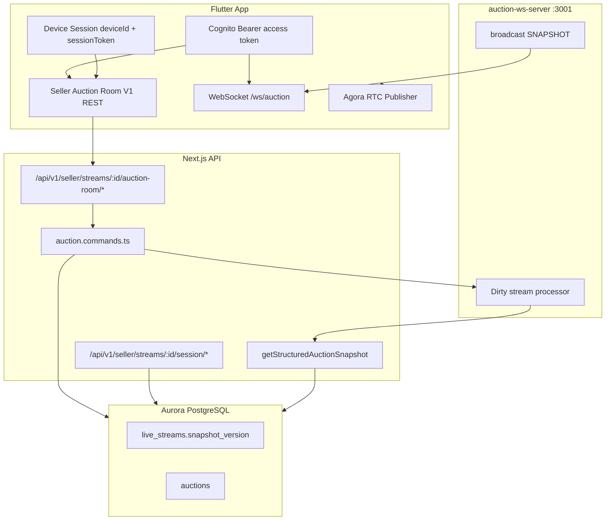

### REST vs realtime responsibilities

| Concern | REST (V1 auction-room) | WebSocket (`/ws/auction`) |
|--------|-------------------------|---------------------------|
| Initial room state | `GET .../auction-room` | First `SNAPSHOT` on connect |
| Queue mutations | `POST/PATCH/DELETE .../queue*` | Follow-up `SNAPSHOT` broadcast |
| Start / end / cancel auction | `POST .../start`, `/end`, `/cancel-room` | Follow-up `SNAPSHOT` (end also sends `AUCTION_ENDED` first) |
| Dutch price reduction | `POST .../dutch/reduce-price` | Follow-up `SNAPSHOT` |
| Live bids, timer, winner | — | `BID_PLACED` event per bid (patch; **no** follow-up `SNAPSHOT`), `AUCTION_ENDED` on close — see `MOBILE_BUYER_AUCTION_ROOM.md` §3.3 |
| Session / device panel | `.../session/*` | `CONTROL_REQUESTS_UPDATED` event |
| Stream ended (lifecycle) | `POST .../end` (stream) | `STREAM_ENDED` event |

### Snapshot synchronization

- **Authority:** Postgres `live_streams.snapshot_version` (monotonic BIGINT).
- **Envelope fields** on every snapshot (REST + WS): `snapshotVersion`, `generatedAt`, `auctionId`, `serverTimestamp`.
- **Client rule:** Apply incoming snapshot only when `incoming.snapshotVersion > local` (`lib/realtime/snapshotVersion.ts` → `shouldApplySnapshot`).
- **Seller merge:** `pickNewerSnapshot(fetchedRest, wsSnapshot)` — no field-level merge.

### Mutation flow

1. Flutter calls a V1 mutation with `Authorization: Bearer` + `deviceId` + `sessionToken`.
2. Server validates **seller role**, **stream ownership**, and **auction controller** session.
3. Domain command runs (`auction.commands.ts`).
4. DB triggers bump `snapshot_version`.
5. Response `data` = fresh `SellerAuctionRoomStructuredSnapshotResponse` (stream, activeAuction, productQueue, …).
6. Optional `meta.depletedRandomProductId` when a random product stock hits zero on end.
7. WS server broadcasts `SNAPSHOT` to all room subscribers.

### Expected lifecycle

```text
Login → pick stream → go live → claim session → (optional) request auction control
→ load snapshot → connect WS → manage queue → start auction → live updates via WS
→ end auction → repeat or end stream → disconnect session → leave room
```

---

## 2. Prerequisites

### Seller authentication

| Item | Value |
|------|--------|
| Header | `Authorization: Bearer <cognito_access_token>` |
| Obtain token | `POST /api/v1/auth/login` with `client:'mobile'` (see MOBILE_AUTH_CONTRACT_V2.md) |
| Bootstrap | `GET /api/v1/seller/auth/me` — verify `data.role === 'seller'` |
| Refresh | Client-side `POST /api/v1/auth/refresh` (see MOBILE_AUTH_CONTRACT_V2.md) on `401` + `error.code === 'AUTH_EXPIRED'` |
| Cookies | **Not required** for `/api/v1/*` |

Implementation: `lib/auth/getAccessToken.ts`, `lib/auth/requireSeller.ts` → `requireSellerFromRequest`.

### Required headers (all V1 calls)

```http
Authorization: Bearer <access_token>
Content-Type: application/json
```

### Device / session requirements

Auction **mutations** (queue, start, end, cancel, Dutch) require:

```json
{
  "deviceId": "<stable-uuid-per-install>",
  "sessionToken": "<from POST .../session/claim>"
}
```

Obtained by claiming a seller stream session **before** entering the auction room. The device with **auction control** may perform mutations; others receive `403` with message *"Only the device with auction control may perform this action"*.

Read-only auction-room endpoints (`GET` snapshot, `GET` queue) require seller auth + stream ownership only — no session body.

### Auction control permissions

| Level | Authorization helper | Who |
|-------|---------------------|-----|
| `seller` | `authorizeSellerAuctionRoomSellerAccess` | Any authenticated seller owning the stream |
| `auctionController` | `authorizeSellerAuctionRoomControllerAccess` | Device with valid `sessionToken` **and** auction control |

Session claim flow:
1. `POST /api/v1/seller/streams/:streamId/session/claim` — first device → PRIMARY + auction control.
2. Secondary device: `POST .../session/auction-control/request` → PRIMARY approves via `.../approve` or rejects via `.../reject`.

### Authorization flow

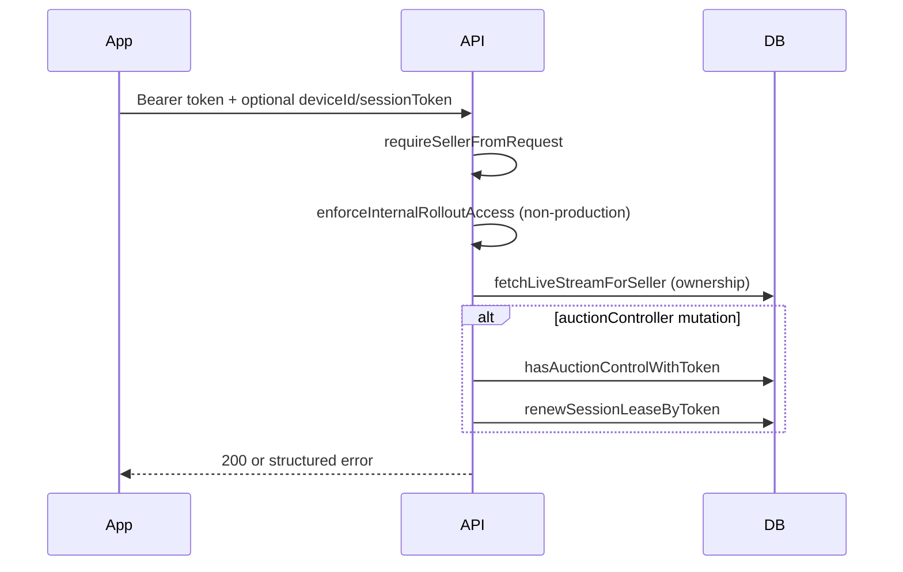

### Error responses when authorization fails

Standard V1 envelope (`lib/api/v1/response.ts`):

```json
{
  "success": false,
  "error": {
    "code": "AUTH_INVALID_TOKEN",
    "message": "Access token is invalid"
  }
}
```

| HTTP | `error.code` | Typical cause |
|------|--------------|-----------------|
| 401 | `AUTH_MISSING_TOKEN` | No `Authorization` header |
| 401 | `AUTH_INVALID_TOKEN` | Bad Bearer token |
| 401 | `AUTH_EXPIRED` | Expired Cognito access token |
| 403 | `AUTH_FORBIDDEN` | Rollout allowlist, wrong stream owner |
| 403 | `AUTH_ROLE_REQUIRED` | User is not `seller` |
| 403 | *(message)* | Invalid session / not auction controller |
| 404 | `NOT_FOUND` | Stream not found |
| 429 | `RATE_LIMITED` | Per-route rate limit |

**Branch on `error.code`, not HTTP status alone.**

### Rollout guard

When `APP_MODE` is `internal_testing` or `prelaunch` **and** `INTERNAL_TESTER_EMAIL_ALLOWLIST` is set, only allowlisted seller emails may call V1 APIs (`lib/api/v1/rolloutGuard.ts`).

---

## 3. Overall Implementation Phases

### Phase 1 — Authentication

| | |
|--|--|
| **Objective** | Establish seller identity and Cognito session |
| **APIs** | `GET /api/v1/seller/auth/me` |
| **UI** | Login screen → seller home |
| **Local state** | `accessToken`, `sellerId`, `sellerType` |
| **Failure** | Show login error; retry login |
| **Retry** | User-initiated |
| **Loading** | Full-screen spinner on bootstrap |
| **Success** | Navigate to stream list |

### Phase 2 — Enter Auction Room

| | |
|--|--|
| **Objective** | Select a `LIVE` or `SCHEDULED` stream and navigate to room |
| **APIs** | `GET /api/v1/seller/streams`, `GET /api/v1/seller/streams/:streamId` |
| **UI** | Stream picker → room shell (tabs: Live / Queue / Chat) |
| **Local state** | `streamId`, `streamStatus` from detail |
| **Failure** | 404 → back to list; 403 → permission message |
| **Retry** | Pull-to-refresh stream detail |
| **Loading** | Stream header skeleton |
| **Success** | Room scaffold visible |

Web reference layout: `SellerAuctionLayout` — mobile tabs `live | queue | chat`.

### Phase 3 — Claim Seller Session

| | |
|--|--|
| **Objective** | Register device, obtain `sessionToken`, establish auction control (or request it) |
| **APIs** | `POST .../session/claim`, optional `.../auction-control/request`, `GET .../session/devices` |
| **UI** | Hidden bootstrap or “Devices” panel |
| **Local state** | `deviceId` (persist per install), `sessionToken`, `sessionId`, `role`, `isAuctionController` |
| **Failure** | 409 if stream terminal; show reconnect |
| **Retry** | Re-claim on token loss |
| **Loading** | Disable auction buttons until session ready |
| **Success** | `sessionToken` stored; heartbeat scheduler started |

**Before mutations:** persist `deviceId` + `sessionToken` securely (Keychain/EncryptedSharedPreferences).

### Phase 4 — Go Live (if stream not LIVE)

| | |
|--|--|
| **Objective** | Transition `SCHEDULED` → `LIVE` |
| **APIs** | `POST /api/v1/seller/streams/:streamId/go-live` (body `{}`) |
| **UI** | “Go Live” bar (blocked if managed stream pending approval) |
| **Local state** | Update `stream.status` to `LIVE` |
| **Failure** | `WAITING_FOR_APPROVAL`, `STREAM_REJECTED` |
| **Retry** | User taps Go Live again after approval |
| **Loading** | Button spinner |
| **Success** | Enable queue + auction controls |

### Phase 5 — Load Initial Snapshot

| | |
|--|--|
| **Objective** | Hydrate authoritative auction state before/alongside WS |
| **APIs** | `GET /api/v1/seller/streams/:streamId/auction-room` |
| **UI** | Queue list, current lot card, status bar |
| **Local state** | Full snapshot + `snapshotVersion` |
| **Failure** | Error banner + retry |
| **Retry** | Exponential backoff, max 3 |
| **Loading** | Room skeleton until first snapshot |
| **Success** | Render queue + idle/running auction UI |

Response includes `realtime.websocket` and `realtime.agora` hints for next phases.

### Phase 6 — Connect Realtime

| | |
|--|--|
| **Objective** | Subscribe to live `SNAPSHOT` updates |
| **APIs** | WebSocket only (URL from snapshot or env) |
| **UI** | Live bid monitor, countdown, connection indicator |
| **Local state** | `wsConnected`, `lastSnapshotVersion`, `lastSequence` |
| **Failure** | `connectionLost` banner after 5 reconnect attempts |
| **Retry** | Exponential backoff reconnect; `resume` on reconnect |
| **Loading** | “Connecting…” on live tab |
| **Success** | `connected == true`, snapshots flowing |

### Phase 7 — Display Queue

| | |
|--|--|
| **Objective** | Show `productQueue` from snapshot |
| **APIs** | `GET .../auction-room/queue` (optional lightweight refresh) |
| **UI** | Ordered product cards with type badges (NORMAL/DUTCH) |
| **Local state** | Derived from latest snapshot |
| **Failure** | Empty vs error states |
| **Retry** | Refetch snapshot |
| **Loading** | Queue shimmer |
| **Success** | Queue rendered |

Queue management allowed when stream is `LIVE` or `SCHEDULED` and not terminal (web: `canManageQueue`).

### Phase 8 — Manage Queue

| | |
|--|--|
| **Objective** | Add/remove/reorder/clear products |
| **APIs** | See [§7 Queue Management Flow](#7-queue-management-flow) |
| **UI** | Add product modal, swipe delete, reorder buttons |
| **Local state** | `queueActionLoading`; **no optimistic queue** |
| **Failure** | Toast with server message; restore from snapshot |
| **Retry** | Single automatic retry on network failure (web: 600ms delay) |
| **Loading** | Queue section spinner |
| **Success** | Refetch snapshot or wait for WS |

### Phase 9 — Start Auction

| | |
|--|--|
| **Objective** | Pop first queue item, create `RUNNING` auction |
| **APIs** | `POST .../auction-room/start` |
| **UI** | Start modal: type, duration 10–60s, optional price/shipping/announcement |
| **Local state** | Disable start when `activeAuction != null` |
| **Failure** | `Auction already running`, `Stream is not live`, `No products in queue` |
| **Retry** | User corrects input |
| **Loading** | Start button spinner |
| **Success** | `activeAuction` appears via WS |

### Phase 10 — Live Auction Updates

| | |
|--|--|
| **Objective** | Show bids, timer, winner, Dutch price |
| **APIs** | WS `BID_PLACED` + `AUCTION_ENDED` + `SNAPSHOT` (no polling required) |
| **UI** | Bid monitor, countdown (`serverOffsetMs`), Dutch reduce modal |
| **Local state** | Timer from `activeAuction.endsAt` + ping/pong server offset, `ceil` rounding (`MOBILE_BUYER_AUCTION_ROOM.md` §3.5) |
| **Failure** | WS disconnect → show stale banner + manual refresh |
| **Retry** | WS reconnect |
| **Loading** | N/A (continuous) |
| **Success** | Prices/timer update on each newer snapshot |

Optional: `GET .../pre-bids?productId=` to show pre-bid panel before start.

### Phase 11 — End / Cancel Auction

| | |
|--|--|
| **Objective** | Settle lot (end) or cancel entire room (cancel-room) |
| **APIs** | `POST .../end`, `POST .../cancel-room` |
| **UI** | End lot button, cancel stream confirmation |
| **Failure** | `No active product auction to end` (end is idempotent-ish — web swallows this) |
| **Retry** | User retry |
| **Loading** | Action spinner |
| **Success** | `lastAuctionResult` in snapshot; winner overlay |

**Deprecated:** `POST .../cancel` — alias for cancel-room; prefer `/cancel-room`.

### Phase 12 — Reconnect & Recovery

| | |
|--|--|
| **Objective** | Restore state after network/app pause |
| **APIs** | WS `resume`, `GET .../auction-room`, session heartbeat |
| **UI** | “Reconnecting…” / “Tap to refresh” |
| **Local state** | Keep `lastSnapshotVersion`, `lastSequence` |
| **Failure** | `AUTH_EXPIRED` on WS → refresh the Cognito session via `POST /api/v1/auth/refresh`, reconnect |
| **Retry** | App resume + visibility → reconnect WS + refetch snapshot |
| **Loading** | Non-blocking banner |
| **Success** | `pickNewerSnapshot` converges |

### Phase 13 — Leaving Auction Room

| | |
|--|--|
| **Objective** | Clean disconnect |
| **APIs** | `POST .../session/disconnect`, optional `POST .../streams/:streamId/end` |
| **UI** | Back navigation, end stream confirmation |
| **Local state** | Clear WS, stop heartbeat, optionally clear session token |
| **Failure** | Log non-fatal; navigate away anyway |
| **Retry** | Best-effort disconnect on next open |
| **Loading** | Brief |
| **Success** | Return to stream list |

---

## 4. Complete API Reference

All paths are prefixed with `/api/v1/seller/streams/{streamId}` unless noted.

**Success envelope:**

```json
{ "success": true, "data": { }, "meta": { } }
```

**Mutation meta** (when applicable):

```json
{ "meta": { "depletedRandomProductId": "uuid-or-null" } }
```

---

### `GET /auction-room`

| | |
|--|--|
| **Auth** | Bearer, seller, stream owner |
| **Authorization level** | `seller` |
| **Rate limit** | 60/min (`seller_auction_room_snapshot`) |
| **Body** | — |

**Success `data`** — `SellerAuctionRoomSnapshotResponseSchema` (`lib/seller/auctionRoom/v1/snapshot.ts`):

```json
{
  "stream": {
    "id": "stream-uuid",
    "sellerId": "seller-uuid",
    "status": "LIVE",
    "title": "Friday Drop",
    "thumbnailUrl": "https://...",
    "bidsPaused": false,
    "chatDisabled": false,
    "scheduledStartTime": null,
    "streamEndsAt": "2026-07-09T15:00:00.000Z",
    "streamDurationMinutes": 120
  },
  "activeAuction": null,
  "endedAuctions": [],
  "productQueue": [
    {
      "productId": "prod-uuid",
      "title": "Nike Air Max",
      "price": 499,
      "startingPrice": 99,
      "auctionType": "NORMAL",
      "bidIncrement": 5,
      "shippingPriceNok": 79,
      "image": "https://..."
    }
  ],
  "mutedUserIds": [],
  "lastAuctionResult": null,
  "snapshotVersion": 42,
  "generatedAt": "2026-07-09T12:00:00.000Z",
  "auctionId": null,
  "serverTimestamp": "2026-07-09T12:00:00.000Z",
  "realtime": {
    "websocket": {
      "path": "/ws/auction?streamId=stream-uuid",
      "streamId": "stream-uuid",
      "accessTokenQueryParam": "access_token"
    },
    "agora": {
      "rtcChannelName": "stream_stream-uuid",
      "rtmChannelName": "auction:stream-uuid"
    }
  }
}
```

**Business logic:** Loads structured snapshot + resolves `lastAuctionResult` + attaches realtime hints.

**Live shipping (seller overlay):** When `activeAuction` is set, read `data.activeAuction.shippingPriceNok` or `data.activeAuction.product.shippingPriceNok` (same amount the seller picked at start). Show it as a small extra line under the current bid. Do **not** add it into `highestBid` / `product.price`. `productQueue[].shippingPriceNok` is catalog shipping for queued items, not the live-lot override.

**Side effects:** None (read-only).

---

### `GET /auction-room/queue`

| | |
|--|--|
| **Auth** | Bearer, seller, stream owner |
| **Rate limit** | 60/min (`seller_auction_room_queue_read`) |

**Success `data`:**

```json
{
  "productQueue": [ { "productId": "...", "title": "...", "price": 0, "...": "..." } ]
}
```

---

### `POST /auction-room/queue`

Add product to queue.

| | |
|--|--|
| **Auth** | Bearer + **auction controller** session |
| **Rate limit** | 60/min (`seller_auction_room_queue_add`) |

**Body** (`SellerAuctionRoomQueueAddBodySchema`):

```json
{
  "deviceId": "device-uuid",
  "sessionToken": "secret-token",
  "productId": "prod-uuid",
  "auctionType": "NORMAL",
  "sourceType": "CATALOG"
}
```

| Field | Rules |
|-------|--------|
| `productId` | 1–200 chars; not JSON string; no `/\` or control chars |
| `auctionType` | `NORMAL` \| `DUTCH` (default `NORMAL`) |
| `sourceType` | `CATALOG` \| `RANDOM` (default `CATALOG`) |

**Success `data`:** `SellerAuctionRoomStructuredSnapshotResponse` (subset of full snapshot — no `lastAuctionResult` / `realtime`).

**Business logic:** `enqueueProductCommand` — rejects duplicates (returns current snapshot). Managed store products with **no shared stock left** are refused with `400 BAD_REQUEST` ("Product is sold out"); seller allocations no longer gate queueing. Stock model: [FLUTTER_SELLER_MANAGED_STOCK_GUIDE.md](./FLUTTER_SELLER_MANAGED_STOCK_GUIDE.md).

**Side effects:** Updates `live_streams.product_queue`, bumps `snapshot_version`, WS broadcast.

---

### `DELETE /auction-room/queue/{productId}`

Remove one product.

| | |
|--|--|
| **Auth** | Auction controller |
| **Body** | `{ "deviceId", "sessionToken" }` |
| **Path** | `productId` validated same as body rules |

**Side effects:** `dequeueProductCommand`.

---

### `PATCH /auction-room/queue/{productId}/position`

Reorder by one step.

**Body:**

```json
{
  "deviceId": "...",
  "sessionToken": "...",
  "direction": "up"
}
```

`direction`: `up` \| `down`.

---

### `POST /auction-room/queue/clear`

**Body:** `{ "deviceId", "sessionToken" }`

**Side effects:** Clears entire queue (`clearQueueCommand`).

---

### `POST /auction-room/start`

Start auction from **first queue item**.

**Body** (`SellerAuctionRoomStartBodySchema`):

```json
{
  "deviceId": "...",
  "sessionToken": "...",
  "auctionType": "NORMAL",
  "durationSec": 60,
  "startingPrice": 99,
  "bidIncrement": 5,
  "shippingPriceNok": 79,
  "isDefectedUnit": false,
  "sellerAnnouncement": "Last size!"
}
```

| Field | Rules |
|-------|--------|
| `durationSec` | int, **10–60**, default 60 |
| `startingPrice` | optional, ≥ 0 |
| `bidIncrement` | optional, ≥ 0.01 (NORMAL) |
| `shippingPriceNok` | optional, ≥ 0, must be allowed seller shipping tier |
| `isDefectedUnit` | optional boolean, default omit/`false`. When `true`, consumes **one** remaining defective unit on **this stream** at start (not at win). Hide the checkbox unless snapshot `product.streamRemainingDefectQuantity > 0`. **409** `CONFLICT` if none remain. Flutter: [FLUTTER_PRODUCT_DEFECTS_GUIDE.md](./FLUTTER_PRODUCT_DEFECTS_GUIDE.md) |
| `sellerAnnouncement` | optional trimmed string |

**Business logic** (`startAuctionFromQueueCommand`):
- Stream must be `LIVE`
- No active product (`product_id` null)
- Queue non-empty — pops first item
- Creates `auctions` row `status: RUNNING`
- Server clamps duration to 5–3600 internally but API validates 10–60

**Errors:** `Stream is not live`, `Auction already running`, `No products in queue`, `Product is sold out` (`400`; managed product with zero shared stock — refetch the snapshot).

---

### `POST /auction-room/end`

End **current running lot** (settlement).

**Body:** `{ "deviceId", "sessionToken" }` (body optional via `optionalJsonObject` mode).

**Side effects:** `endAuctionCommand` — atomic end + settlement; may return `meta.depletedRandomProductId`. For a managed product the winning sale claims **one unit** of shared stock (idempotent per auction id); when stock reaches 0 the product is removed from every live/scheduled stream queue and a new snapshot is broadcast.

**Note:** Web treats *"No active product auction to end"* as success (no-op).

---

### `POST /auction-room/cancel-room`

Cancel **entire room** (stream → `CANCELLED`, clears queue).

**Body:** `{ "deviceId", "sessionToken" }`

**Side effects:** `cancelAuction` — sets stream `CANCELLED`, clears `product_queue`, cancels running auctions.

---

### `POST /auction-room/cancel` ⚠️ Deprecated

Backward-compatible alias — **same behavior as `/cancel-room`**. Use `/cancel-room` for new mobile code.

---

### `POST /auction-room/dutch/reduce-price`

**Body:**

```json
{
  "deviceId": "...",
  "sessionToken": "...",
  "newPrice": 150,
  "offerDurationSec": 30
}
```

| Field | Rules |
|-------|--------|
| `newPrice` | finite number, **< current Dutch price**, **≥ floor (bottom) price** |
| `offerDurationSec` | optional; clamped 5–3600 server-side |

**Errors:** `Only Dutch auctions support price reduction`, `No running auction found`.

---

### Session endpoints (required for mutations)

Base: `/api/v1/seller/streams/{streamId}/session`

#### `POST /claim`

**Body:** `{ "deviceId": "uuid" }`

**Success `data`:**

```json
{
  "session": { "id": "...", "streamId": "...", "deviceId": "...", "sessionRole": "PRIMARY", "...": "..." },
  "role": "PRIMARY",
  "isPrimary": true,
  "sessionToken": "opaque-token",
  "message": "optional",
  "snapshot": {
    "devices": [],
    "pendingRequests": [],
    "auctionControllerDeviceId": "device-uuid",
    "pendingAuctionControlRequests": []
  }
}
```

**Side effects:** Creates/updates `seller_stream_sessions`; broadcasts `CONTROL_REQUESTS_UPDATED`.

**Error:** 409 if stream terminal (*"Stream has ended and cannot accept new control sessions"*).

#### `POST /heartbeat`

**Body:** `{ "sessionId": "session-uuid-from-claim" }`

**Success:** `{ "success": true, "sessionId": "..." }`

Send every ~20s while in room (web: `LEASE_RENEW_INTERVAL_MS = 20000`).

#### `POST /disconnect`

**Body:** `{ "deviceId", "sessionToken", "reason?": "explicit_disconnect" }`

#### `GET /devices`

**Success `data`:** session snapshot (devices + pending control requests).

#### `POST /auction-control/request`

**Body:** `{ "deviceId", "sessionToken" }` — secondary requests control.

#### `POST /auction-control/approve` / `reject`

**Body:** `{ "deviceId", "sessionToken", "requestId": "uuid" }` — **auction controller only**.

---

### Stream lifecycle (adjacent)

| Endpoint | Purpose |
|----------|---------|
| `POST /api/v1/seller/streams/:streamId/go-live` | `{}` → `{ wentLive: true, stream }` |
| `POST /api/v1/seller/streams/:streamId/end` | End entire stream |
| `GET /api/v1/seller/streams/:streamId/pre-bids?productId=` | Pre-bids for queue item |

---

## 5. Flutter Integration

### Dio client + envelope parsing

```dart
// lib/core/network/tommesalg_api_client.dart
import 'package:dio/dio.dart';

class TommesalgApiException implements Exception {
  TommesalgApiException({required this.code, required this.message, this.statusCode});
  final String code;
  final String message;
  final int? statusCode;
}

class TommesalgApiClient {
  TommesalgApiClient({required Dio dio}) : _dio = dio;
  final Dio _dio;

  Future<T> getData<T>(
    String path, {
    Map<String, dynamic>? queryParameters,
    required T Function(Map<String, dynamic> json) parse,
  }) async {
    final response = await _dio.get<Map<String, dynamic>>(
      path,
      queryParameters: queryParameters,
    );
    return _unwrap(response.data, parse);
  }

  Future<T> postData<T>(
    String path, {
    Map<String, dynamic>? body,
    required T Function(Map<String, dynamic> json) parse,
  }) async {
    final response = await _dio.post<Map<String, dynamic>>(path, data: body);
    return _unwrap(response.data, parse);
  }

  T _unwrap<T>(Map<String, dynamic>? body, T Function(Map<String, dynamic>) parse) {
    if (body == null) throw TommesalgApiException(code: 'INTERNAL_ERROR', message: 'Empty body');
    if (body['success'] == false) {
      final err = body['error'] as Map<String, dynamic>? ?? {};
      throw TommesalgApiException(
        code: err['code'] as String? ?? 'INTERNAL_ERROR',
        message: err['message'] as String? ?? 'Request failed',
      );
    }
    final data = body['data'];
    if (data is! Map<String, dynamic>) {
      throw TommesalgApiException(code: 'INTERNAL_ERROR', message: 'Invalid data envelope');
    }
    return parse(data);
  }
}
```

Configure Dio interceptor:

```dart
_dio.interceptors.add(InterceptorsWrapper(
  onRequest: (options, handler) async {
    final token = await authSession.getAccessToken();
    if (token != null) {
      options.headers['Authorization'] = 'Bearer $token';
    }
    handler.next(options);
  },
  onError: (error, handler) async {
    final data = error.response?.data;
    if (data is Map && data['error']?['code'] == 'AUTH_EXPIRED') {
      await authSession.refresh(); // POST /api/v1/auth/refresh
      // retry once...
    }
    handler.next(error);
  },
));
```

### Models (json_serializable / freezed)

Mirror `StructuredAuctionSnapshot` + response wrappers:

```dart
// lib/features/seller_auction_room/data/models/auction_room_snapshot.dart
import 'package:freezed_annotation/freezed_annotation.dart';

part 'auction_room_snapshot.freezed.dart';
part 'auction_room_snapshot.g.dart';

@freezed
class AuctionRoomSnapshot with _$AuctionRoomSnapshot {
  const factory AuctionRoomSnapshot({
    required StreamSnapshot stream,
    ActiveAuctionSnapshot? activeAuction,
    @Default([]) List<EndedAuctionSnapshot> endedAuctions,
    @Default([]) List<AuctionProduct> productQueue,
    @Default([]) List<String> mutedUserIds,
    LastAuctionResult? lastAuctionResult,
    @Default(0) int snapshotVersion,
    required String generatedAt,
    String? auctionId,
    required String serverTimestamp,
    RealtimeHints? realtime,
  }) = _AuctionRoomSnapshot;

  factory AuctionRoomSnapshot.fromJson(Map<String, dynamic> json) =>
      _$AuctionRoomSnapshotFromJson(json);
}

@freezed
class SellerSessionAuth with _$SellerSessionAuth {
  const factory SellerSessionAuth({
    required String deviceId,
    required String sessionToken,
  }) = _SellerSessionAuth;
}
```

### Repository

```dart
// lib/features/seller_auction_room/data/repositories/seller_auction_room_repository.dart
class SellerAuctionRoomRepository {
  SellerAuctionRoomRepository(this._api);
  final TommesalgApiClient _api;

  String _room(String streamId, [String suffix = '']) =>
      '/api/v1/seller/streams/${Uri.encodeComponent(streamId)}/auction-room$suffix';

  Future<AuctionRoomSnapshot> getSnapshot(String streamId) => _api.getData(
        _room(streamId),
        parse: AuctionRoomSnapshot.fromJson,
      );

  Future<MutationResult> enqueue({
    required String streamId,
    required SellerSessionAuth auth,
    required String productId,
    AuctionType auctionType = AuctionType.normal,
    SourceType sourceType = SourceType.catalog,
  }) async {
    final response = await _api.postData<Map<String, dynamic>>(
      _room(streamId, '/queue'),
      body: {
        ...auth.toJson(),
        'productId': productId,
        'auctionType': auctionType.name.toUpperCase(),
        'sourceType': sourceType.name.toUpperCase(),
      },
      parse: (j) => j,
    );
    return MutationResult(
      snapshot: StructuredSnapshot.fromJson(response),
      depletedRandomProductId: null, // read from raw meta if needed
    );
  }

  // start, end, cancelRoom, dequeue, reorder, clear, reduceDutchPrice — same pattern
}
```

### Riverpod controller (snapshot-authoritative)

```dart
// lib/features/seller_auction_room/presentation/auction_room_controller.dart
@riverpod
class AuctionRoomController extends _$AuctionRoomController {
  @override
  AsyncValue<AuctionRoomState> build(String streamId) {
    ref.onDispose(() => _ws?.close());
    _bootstrap();
    return const AsyncValue.loading();
  }

  AuctionRoomSnapshot? _local;
  WebSocketChannel? _ws;

  Future<void> _bootstrap() async {
    final repo = ref.read(sellerAuctionRoomRepositoryProvider);
    final session = await ref.read(sellerSessionServiceProvider).ensureSession(streamId);
    final snap = await repo.getSnapshot(streamId);
    _applySnapshot(snap);
    await _connectWs(streamId, snap.realtime);
  }

  void _applySnapshot(AuctionRoomSnapshot incoming) {
    final currentV = _local?.snapshotVersion ?? 0;
    if (incoming.snapshotVersion <= currentV && currentV > 0) return;
    _local = incoming;
    state = AsyncValue.data(AuctionRoomState.fromSnapshot(incoming));
  }

  Future<void> startAuction(StartAuctionParams params) async {
    final auth = ref.read(sellerSessionAuthProvider(streamId)).requireValue;
    final result = await ref.read(sellerAuctionRoomRepositoryProvider).start(
          streamId: streamId,
          auth: auth,
          params: params,
        );
    _applySnapshot(result.snapshot.toFullSnapshot(_local));
  }
}
```

**Pattern:** Commands never patch local queue optimistically — wait for snapshot (WS or mutation response + refetch), matching `useSellerAuction`.

### Error handling example

```dart
try {
  await repo.enqueue(...);
} on TommesalgApiException catch (e) {
  final message = switch (e.code) {
    'AUTH_FORBIDDEN' => 'This device cannot control auctions. Request control from the primary device.',
    'VALIDATION_ERROR' => 'Invalid product or request.',
    'RATE_LIMITED' => 'Too many requests — wait a moment.',
    _ => e.message,
  };
  ref.read(toastServiceProvider).showError(message);
}
```

---

## 6. State Management

### Cache locally (with version gate)

| State | Source | Notes |
|-------|--------|-------|
| `snapshotVersion` | REST + WS | Monotonic gate |
| Latest full snapshot | `pickNewerSnapshot(rest, ws)` | Replace on `SNAPSHOT`; only `BID_PLACED` / `AUCTION_ENDED` patch fields |
| `deviceId`, `sessionToken`, `sessionId` | Secure storage | Per stream |
| `serverOffsetMs` | WS ping/pong: `serverTs - (t0 + t1) / 2` from lowest-RTT sample (`MOBILE_BUYER_AUCTION_ROOM.md` §3.5) | Countdown sync — do not derive from snapshot `serverTimestamp` |
| `lastWsSequence` | WS envelope | Reconnect `resume` |
| UI tab selection | Local | Ephemeral |

### Always from server

| State | Never guess locally |
|-------|---------------------|
| `productQueue` order | |
| `activeAuction` / bids / winner | |
| `stream.status` | Clamp with stream detail if WS lags after end |
| `lastAuctionResult` | |
| Dutch `currentPrice` | |
| Auction controller device | `GET .../session/devices` |

### Snapshot handling

```dart
bool shouldApplySnapshot(int? current, int? incoming) {
  if (incoming == null) return true;
  if (current == null) return true;
  return incoming > current;
}
```

### Optimistic updates

**None** for auction room state. The web hook explicitly documents: *"SNAPSHOT IS TRUTH — no optimistic updates"*. Show loading spinners on mutations (`queueActionLoading`).

### Rollback

On mutation failure, keep last good snapshot. On success, apply mutation response snapshot then optionally refetch full `GET /auction-room` for `lastAuctionResult` + `realtime` hints.

### Refresh strategy

| Event | Action |
|-------|--------|
| WS `SNAPSHOT` | Apply if newer version |
| After queue mutation | Refetch snapshot (web always refetches queue ops) |
| After start/end/cancel | Refetch if WS disconnected |
| App resume | Reconnect WS + `GET /auction-room` |
| Stream may have ended | Poll `GET /api/v1/seller/streams/:id` every 45s or on tab focus |

---

## 7. Queue Management Flow

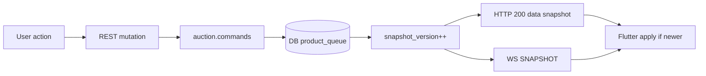

| Action | API | Local change | Refresh |
|--------|-----|--------------|---------|
| Load queue | `GET /auction-room` or `/queue` | Set `productQueue` from `data` | Initial load |
| Add | `POST /queue` | None until response | Response snapshot + optional full GET |
| Remove | `DELETE /queue/{id}` | None | Same |
| Reorder | `PATCH /queue/{id}/position` | None | Same + web always refetches |
| Clear | `POST /queue/clear` | None | Same |

**Business rules:**
- Duplicate `productId` → success with unchanged queue (idempotent enqueue).
- `sourceType: RANDOM` for random-inventory products.
- Queue editable when stream `LIVE` or `SCHEDULED`, not terminal.

---

## 8. Auction Lifecycle

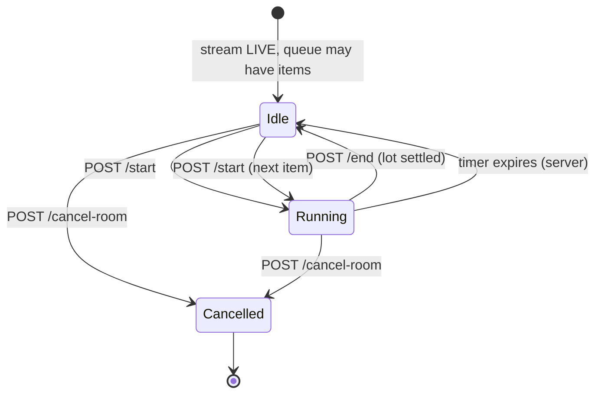

### Before auction

- Stream status `LIVE` (or `SCHEDULED` for queue-only prep).
- `activeAuction == null`.
- Queue populated.

### Starting

- `POST /start` pops queue head, inserts `auctions` `RUNNING`.
- Snapshot gains `activeAuction` with `endsAt`, `startedAt`, product, type.

### Running

- WS `BID_PLACED` updates `highestBid`, `bidCount`, `winner`, `endsAt` immediately; snapshots update Dutch price and recover state.
- Live shipping is `activeAuction.shippingPriceNok` / `activeAuction.product.shippingPriceNok` (seller-selected at start). Show next to the bid; do not add into `highestBid`.
- Seller may `POST /dutch/reduce-price` (Dutch only).

### Ending

- `POST /end` → settlement, `lastAuctionResult` populated, `activeAuction` cleared.
- Check `meta.depletedRandomProductId` for random stock exhaustion alert.

### Completed

- Stream still `LIVE`; ready for next `POST /start` if queue non-empty.

### Cancelled

- `POST /cancel-room` → stream `CANCELLED`, queue cleared, running auctions stopped.

---

## 9. Snapshot Synchronization

### When to load

1. On room entry (`GET /auction-room`).
2. When WS not yet connected.
3. After mutations if WS disconnected.
4. On app resume / manual refresh.

### When to refresh

- After every queue mutation (recommended — matches web).
- On WS reconnect if `resume` replay empty (server sends full snapshot).
- When `CONTROL_REQUESTS_UPDATED` received → refresh session devices + optionally snapshot.

### Versioning

- DB authority: `live_streams.snapshot_version`.
- Compare with `shouldApplySnapshot` / `pickNewerSnapshot`.
- Missing version on either side → accept (rollout tolerance).

### Conflict handling

Duplicates and out-of-order WS delivery are harmless: stale versions discarded.

### Stale snapshot detection

If UI shows `LIVE` but seller ended stream elsewhere:
- Refetch `GET /api/v1/seller/streams/:id`
- Clamp UI to `ENDED` when DB says so (web `streamStatusForUi` pattern).

### Reconnect behavior

1. Open WS with fresh `access_token` query param.
2. Send `{ "type": "resume", "lastSequence": N, "requestId": "uuid" }`.
3. Receive `WS_RESUME_ACK` + replay or full snapshot.
4. Apply only snapshots with `snapshotVersion > local`.

---

## 10. Realtime Integration

### Connection URL

From snapshot `realtime.websocket`:

```text
{wssBase}/ws/auction?streamId={streamId}&access_token={cognitoAccessToken}
```

Or env: `NEXT_PUBLIC_WS_URL` / host `NEXT_PUBLIC_WS_HOST` + port `3001` (web defaults).

**Flutter:** Use `wss://` in production. Append token on each connect (refresh if `AUTH_EXPIRED`).

### Client → server messages

| type | Purpose |
|------|---------|
| `resume` | Reconnect; `{ lastSequence, requestId }` |
| `ping` | Heartbeat (server replies `pong`) |
| `pong` | Response to server ping |

### Server → client messages

| type | Payload | Action |
|------|---------|--------|
| `SNAPSHOT` | Full structured snapshot + `sequence`, `eventId` | Apply if newer `snapshotVersion` |
| `STREAM_ENDED` | Stream lifecycle | Navigate to ended UI |
| `CHAT_MODE_CHANGED` | `{ enabled }` | Update chat input state |
| `USER_MUTED` | `{ userId, muted }` | Update muted set |
| `CHAT_CLEARED` | — | Clear chat UI |
| `MESSAGE_DELETED` | `{ messageId }` | Remove message |
| `CONTROL_REQUESTS_UPDATED` | control metadata | Refresh devices panel |
| `AUTH_EXPIRED` / `WS_ERROR` | auth codes | Refresh token, reconnect |
| `WS_RESUME_ACK` | replay metadata | Diagnostics |

### Reconnect strategy (from `useAuctionWS`)

- Max **5** attempts.
- Backoff: `min(1000 * 2^(attempt-1), 10000)` ms.
- Skip reconnect while app backgrounded (`visibility hidden`).
- On foreground: reset attempts, reconnect.

### Heartbeat

Server supports `ping`/`pong`. Client `resume` on each successful `onOpen`.

### Event ordering

- **Convergence key:** `snapshotVersion` (not WS `sequence`).
- `sequence` is per-process, best-effort replay only.

### Duplicate handling

Ignore snapshots where `incoming.snapshotVersion <= local`.

### Snapshot recovery after reconnect

If replay buffer empty → server calls `sendSnapshot` (authoritative full state).

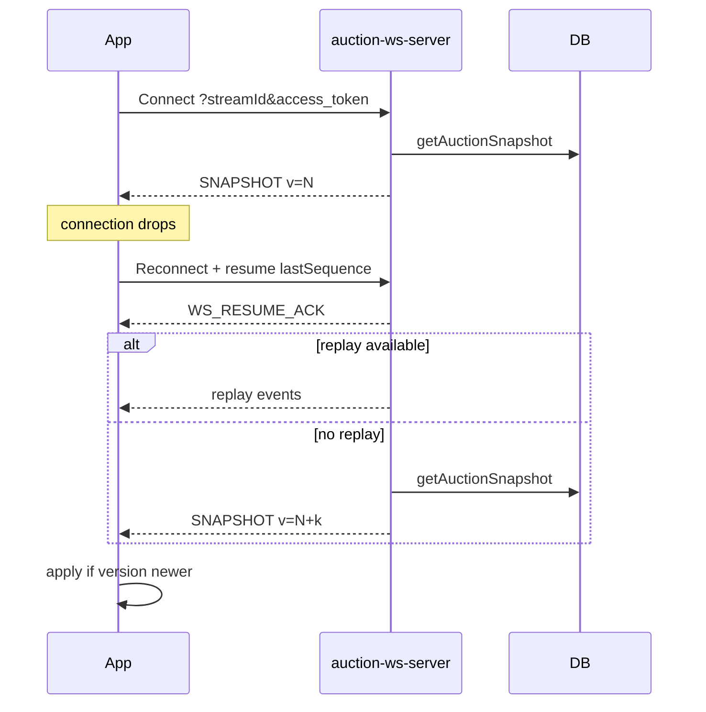

---

## 11. Error Handling

### Per-endpoint failures

| Endpoint | Common errors | HTTP | User message |
|----------|---------------|------|--------------|
| All | Missing/invalid token | 401 | "Session expired — log in again" |
| All | Not stream owner | 404 | "Stream not found" |
| All | Rate limited | 429 | "Slow down — try again shortly" |
| Mutations | Not auction controller | 403 | "Request auction control from primary device" |
| Mutations | Invalid session | 403 | "Session expired — re-enter room" |
| POST /queue | Duplicate product | 200 | No-op (queue unchanged) |
| POST /queue | Allocation gate | 400 | Server message (inventory) |
| POST /start | Not LIVE | 400 | "Go live before starting" |
| POST /start | Already running | 400 | "End current auction first" |
| POST /start | Empty queue | 400 | "Add products to queue" |
| POST /start | Validation | 400 | Duration 10–60 seconds |
| POST /start | `isDefectedUnit: true` and this-stream remaining is 0 | 409 | "No remaining defective units on this stream" |
| POST /end | No active auction | 400 | Safe to ignore (web no-op) |
| POST /cancel-room | Wrong stream state | 400 | "Cannot cancel from current state" |
| Dutch reduce | Not Dutch / price rules | 400 | Show validation message |
| POST /claim | Stream ended | 409 | "Stream has ended" |
| POST /heartbeat | Session gone | 401 | Re-claim session |

### Retry recommendations

| Error | Retry |
|-------|-------|
| Network timeout / failed to fetch | 1 retry after 600ms (queue ops) |
| 429 | Backoff 30s |
| 401 AUTH_EXPIRED | refresh the Cognito session via `POST /api/v1/auth/refresh`, retry once |
| 403 session | Re-claim session |
| 400 business | Do not auto-retry |

---

## 12. Offline & Recovery

### App resumes

1. refresh the Cognito session via `POST /api/v1/auth/refresh` if needed.
2. `POST /session/heartbeat` or re-`claim` if heartbeat fails.
3. Reconnect WebSocket with `resume`.
4. `GET /auction-room` and apply if newer than local.

### Internet loss

- Show offline banner; queue mutations disabled.
- Keep last snapshot for read-only display (mark as stale).
- Do not optimistically apply pending actions.

### Duplicate requests

- Enqueue duplicate `productId` → idempotent success.
- Double-tap start: second request should fail `Auction already running` — disable button while in flight.

### Idempotency

- Mutations are **not** globally idempotent except duplicate enqueue.
- Use UI debouncing + `queueActionLoading` guard.

### State recovery

Trust highest `snapshotVersion` across REST and WS. After recovery, call `GET .../session/devices` to restore control permissions.

---

## 13. Recommended Mobile Architecture

```text
lib/
  features/
    seller_auction_room/
      data/
        models/           # freezed DTOs mirroring Zod schemas
        repositories/     # SellerAuctionRoomRepository, SellerSessionRepository
        services/
          auction_room_api_service.dart
          seller_session_service.dart
          auction_websocket_service.dart
        mappers/          # snapshot → view models (like normalizeAuction)
      domain/
        entities/
        use_cases/
          claim_session.dart
          load_auction_snapshot.dart
          enqueue_product.dart
          start_auction.dart
      presentation/
        screens/
          auction_room_screen.dart
          queue_tab.dart
          live_tab.dart
          chat_tab.dart
        widgets/
        controllers/      # Riverpod notifiers
        state/
          auction_room_state.dart
      di/
        providers.dart
```

| Layer | Responsibility |
|-------|----------------|
| **data/models** | JSON serialization matching server Zod |
| **data/repositories** | Envelope unwrap, meta extraction |
| **data/services/websocket** | WS lifecycle, resume, version gate |
| **domain/use_cases** | Orchestration, validation (duration 10–60) |
| **presentation** | UI, loading/error empty states |
| **controllers** | Snapshot-authoritative state, no optimistic queue |

---

## 14. Complete Screen Flow

### 1. Login

- **API:** `GET /api/v1/seller/auth/me`
- **States:** loading → success (seller) / error (not seller)

### 2. Stream list

- **API:** `GET /api/v1/seller/streams?page=1&pageSize=20`
- **Navigate:** tap stream → stream hub

### 3. Stream hub / pre-live

- **API:** `GET /api/v1/seller/streams/:id`
- **If SCHEDULED:** show schedule overlay; **Go Live** → `POST /go-live`
- **Navigate:** Enter auction room

### 4. Session bootstrap (invisible or devices sheet)

- **API:** `POST /session/claim`
- **Store:** `sessionToken`, start heartbeat timer
- **If secondary:** show "Request control" → `/auction-control/request`

### 5. Auction room — Live tab

- **API:** `GET /auction-room` + WS connect
- **Loading:** until first snapshot
- **Empty:** no active lot — show "Start from queue"
- **Running:** bid monitor, timer, end button
- **Error:** connection lost banner

### 6. Auction room — Queue tab

- **API:** queue mutations
- **Empty:** "Add products" CTA
- **Loading:** `queueActionLoading` overlay

### 7. Start auction modal

- **API:** `POST /start`
- **Validate:** duration 10–60, prices optional

### 8. Dutch controls (conditional)

- **API:** `POST /dutch/reduce-price`

### 9. Winner overlay

- **Data:** `lastAuctionResult` from snapshot (no extra API)

### 10. End stream

- **API:** `POST /api/v1/seller/streams/:id/end`
- **Navigate:** stream ended summary

### 11. Leave room

- **API:** `POST /session/disconnect`
- **Navigate:** back to stream list

---

## 15. Sequence Diagrams

### Entering room

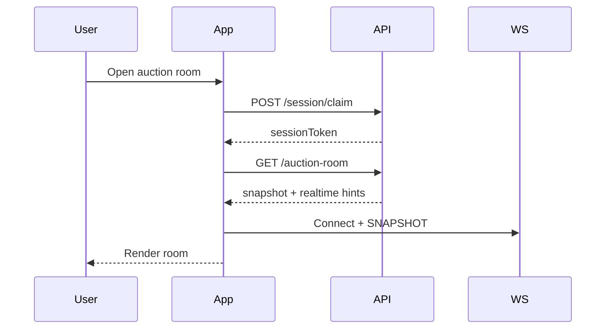

### Loading snapshot

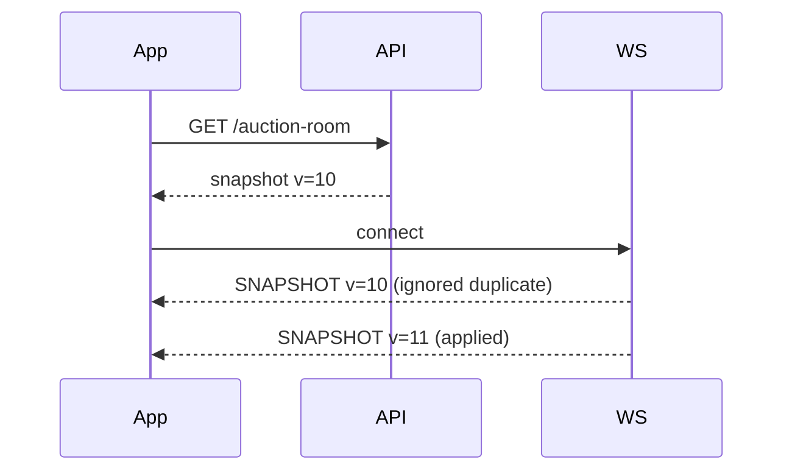

### Queue operations

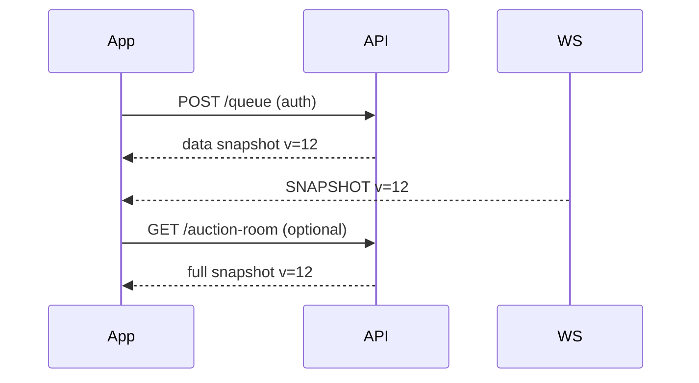

### Starting auction

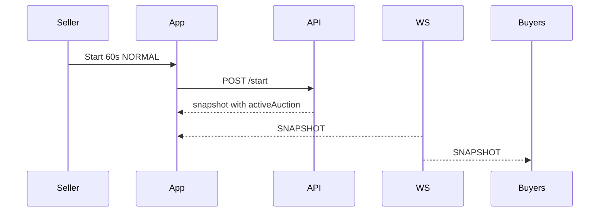

### Ending auction

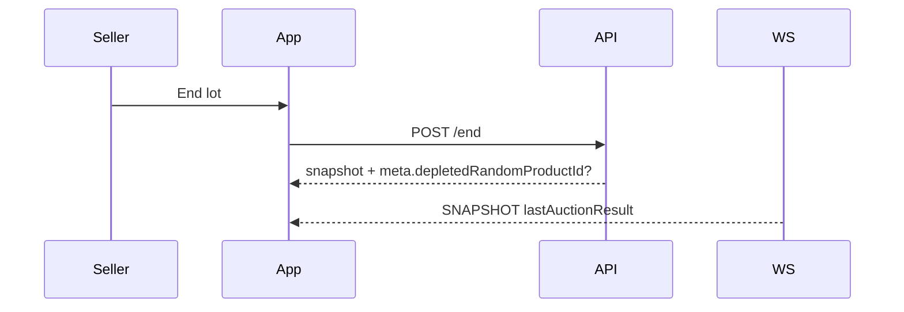

### Realtime updates (buyer bids)

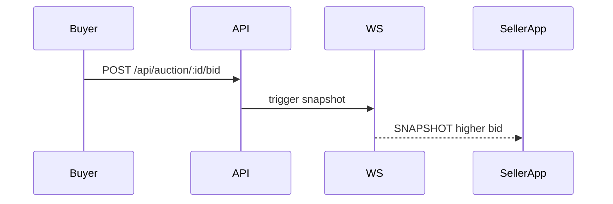

### Reconnect flow

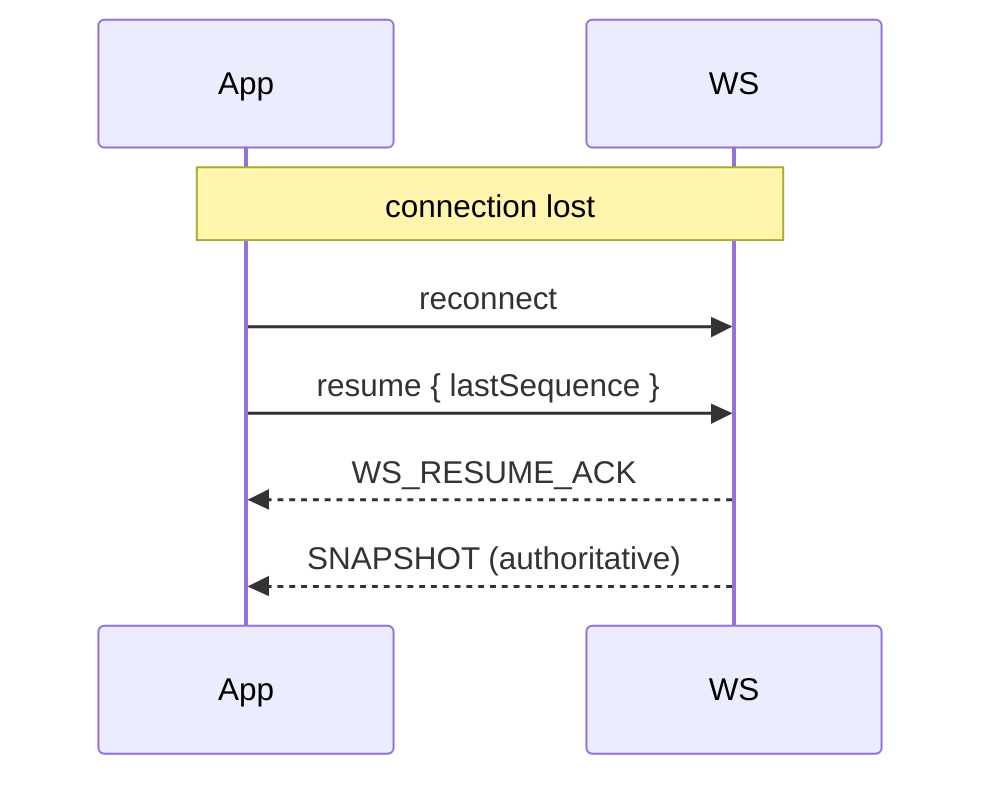

---

## 16. Best Practices

| Topic | Recommendation |
|-------|----------------|
| **Polling** | Avoid for auction state; use WS. Poll stream detail ~45s for terminal status clamp only. |
| **Retry policy** | 1 retry on network for queue ops; exponential backoff for WS (max 5). |
| **Exponential backoff** | WS: 1s, 2s, 4s, 8s, 10s cap. |
| **Caching** | In-memory snapshot only; persist session tokens securely. |
| **Timeouts** | HTTP 30s; WS connect 15s. |
| **Logging** | Log `snapshotVersion`, `streamId`, mutation endpoint; never log `sessionToken`. |
| **Analytics** | `auction_room_entered`, `auction_started`, `auction_ended`, `ws_reconnect`, `mutation_error` + `error.code`. |
| **Crash reporting** | Attach `snapshotVersion`, `wsConnected`, `hasAuctionControl`. |
| **Performance** | Keep WS single per room; debounce device panel refresh (3s min on `CONTROL_REQUESTS_UPDATED`). |

---

## 17. Implementation Checklist

### Authentication & setup
- [ ] Cognito login (`client:"mobile"`) + Bearer interceptor with refresh-on-AUTH_EXPIRED
- [ ] `GET /api/v1/seller/auth/me` bootstrap
- [ ] Token refresh on `AUTH_EXPIRED`
- [ ] Rollout / allowlist handling (non-prod)

### Session & control
- [ ] Stable `deviceId` generation + persistence
- [ ] `POST /session/claim` on room entry
- [ ] Heartbeat every ~20s with `sessionId`
- [ ] `GET /session/devices` UI for multi-device
- [ ] Auction control request / approve flow for secondary devices
- [ ] `POST /session/disconnect` on leave

### Stream lifecycle
- [ ] Stream list + detail
- [ ] `POST /go-live` when scheduled
- [ ] `POST /streams/:id/end` to terminate stream
- [ ] Terminal stream UI (no mutations)

### Snapshot & state
- [ ] `GET /auction-room` initial load
- [ ] `snapshotVersion` gate (`shouldApplySnapshot`)
- [ ] `pickNewerSnapshot` between REST and WS
- [ ] `serverOffsetMs` for countdown
- [ ] Separate `streamStatus` vs `auctionStatus` in UI
- [ ] No optimistic queue mutations

### WebSocket
- [ ] Build URL from `realtime.websocket` + token query param
- [ ] Handle `SNAPSHOT`, `STREAM_ENDED`, `CONTROL_REQUESTS_UPDATED`
- [ ] `resume` on reconnect with `lastSequence`
- [ ] Reconnect backoff (max 5) + `connectionLost` UI
- [ ] Refresh token on `AUTH_EXPIRED` / `WS_AUTH_*`

### Queue
- [ ] Display `productQueue` from snapshot
- [ ] `POST /queue` with `auctionType` + `sourceType`
- [ ] `DELETE /queue/{productId}`
- [ ] `PATCH /queue/{productId}/position`
- [ ] `POST /queue/clear`
- [ ] Refetch after mutations
- [ ] `queueActionLoading` indicator

### Auction controls
- [ ] Guard: auction controller session required
- [ ] `POST /start` with duration 10–60 validation
- [ ] `POST /end` + depleted random product alert from `meta`
- [ ] `POST /cancel-room` (not legacy `/cancel`)
- [ ] Dutch `POST /dutch/reduce-price`
- [ ] Winner overlay from `lastAuctionResult`
- [ ] Disable start when `activeAuction != null`

### Optional / adjacent
- [ ] `GET /pre-bids?productId=`
- [ ] Agora RTC publisher (`realtime.agora.rtcChannelName`)
- [ ] Chat moderation V1 routes under `/chat/*`
- [ ] Parity test run against staging fixtures

### Quality
- [ ] Branch errors on `error.code`
- [ ] Integration tests for envelope parsing
- [ ] Manual test with `scripts/validation/seller-auction-room-v1-parity.mjs`

---

## Appendix A — Legacy vs V1

| Concern | Legacy (web cookies) | Mobile V1 |
|---------|---------------------|-----------|
| Session claim | `/api/seller/stream-session/claim-control` | `/api/v1/seller/streams/:id/session/claim` |
| Queue mutations | `/api/auction/:streamId/queue` | `/api/v1/seller/streams/:id/auction-room/queue` |
| Snapshot | `/api/auction/:streamId/snapshot` | `/api/v1/seller/streams/:id/auction-room` |
| Auth | Cookie + `x-user-id` | `Authorization: Bearer` |

Mobile must use **V1** paths only.

## Appendix B — Structured mutation response shape

Mutations return `SellerAuctionRoomStructuredSnapshotResponse`:

```json
{
  "stream": { "id": "...", "sellerId": "...", "status": "LIVE" },
  "activeAuction": null,
  "endedAuctions": [],
  "productQueue": [],
  "mutedUserIds": []
}
```

Full snapshot (`GET /auction-room`) adds: `lastAuctionResult`, `snapshotVersion`, `generatedAt`, `auctionId`, `serverTimestamp`, `realtime`.

## Appendix C — Validation reference

All mutation body schemas: `lib/seller/auctionRoom/v1/queueValidation.ts`.

## Appendix D — Reference parity script env

```bash
BASE_URL=https://staging.example.com
V1_STREAM_ID=...
SELLER_V1_ACCESS_TOKEN=...
SELLER_SESSION_DEVICE_ID=...
SELLER_SESSION_TOKEN=...
PRODUCT_A_ID=...
PRODUCT_B_ID=...
WS_URL=wss://ws.example.com/ws/auction
REQUIRE_REALTIME=1
```

Run: `node scripts/validation/seller-auction-room-v1-parity.mjs`
