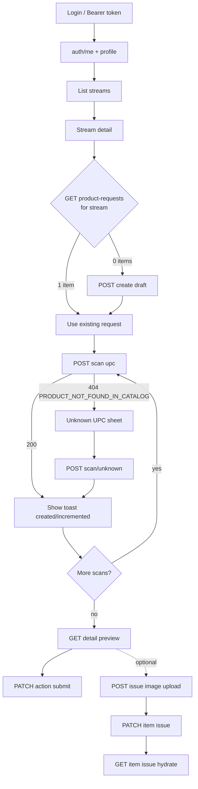

# Seller Mobile — Product Request API Flow

Handoff document for mobile developers integrating the **managed seller** operational workflow: pick a stream, scan UPCs into a product request, submit for fulfillment.

**Base path:** `/api/v1/seller/*`  
**Postman:** `docs/api/postman/Tommesalg API.postman_collection.json` → folder **Seller Mobile (V1)**  
**Stock behaviour (scan → sell → sold out):** [FLUTTER_SELLER_MANAGED_STOCK_GUIDE.md](./FLUTTER_SELLER_MANAGED_STOCK_GUIDE.md)  
**Zod contracts (source of truth):** `lib/contracts/seller/streams.ts`, `lib/contracts/seller/productRequests.ts`, `lib/contracts/seller/productRequestIssues.ts`, `lib/contracts/seller/productDefects.ts`, `lib/contracts/seller/productShipping.ts`

---

## Scope

This API surface is **product intake + stream assignment**, not a full seller control center.

| In scope | Out of scope (do not expect these endpoints) |
|----------|-----------------------------------------------|
| Login bootstrap + profile | Stream create / edit / delete |
| Stream picker + detail | Queue reorder, live auction controls |
| Product request list / create / detail | RTC / RTM tokens, websocket subscriptions |
| UPC scan (known + unknown) | Seller inventory management |
| Submit / cancel (draft only) | Analytics dashboards |
| Issue reporting per line item (photo + message) | Admin issue resolution UI (mobile reports only) |
| Size/spec photos on known catalog products (gallery) | Inventory Quick View size-spec upload |
| Defect photos + qty on known catalog products (draft only) | Independent sellers / stream-random products |
| Product shipping (Frakt) on known catalog products | Independent sellers / stream-random products |

**Audience:** `role = seller` and `seller_account_type ≠ independent` (managed sellers only). Independent sellers receive `403 AUTH_FORBIDDEN` on product-request and stream-picker endpoints.

---

## Authentication

| Item | Value |
|------|--------|
| Header | `Authorization: Bearer <cognito_access_token>` |
| Obtain token | `POST /api/v1/auth/login` `{ email, password, client:'mobile' }` (see MOBILE_AUTH_CONTRACT_V2.md) |
| Refresh | **Client-side only** — call `POST /api/v1/auth/refresh` (see MOBILE_AUTH_CONTRACT_V2.md) when API returns `401` with `error.code === 'AUTH_EXPIRED'`. There is no `/api/v1/seller/auth/refresh`. |
| Bootstrap | `GET /api/v1/seller/auth/me` — verify `role === 'seller'`, read `sellerType`, `approvalStatus` |

### Standard success envelope

```json
{
  "success": true,
  "data": { },
  "meta": { }
}
```

### Standard error envelope

```json
{
  "success": false,
  "error": {
    "code": "NOT_FOUND",
    "message": "Human-readable message"
  }
}
```

**Branch on `error.code`, never on HTTP status alone and never on `error.message` text.**

---

## End-to-end flow (recommended call order)

```text
1.  GET  /api/v1/seller/auth/me
2.  GET  /api/v1/seller/profile
3.  GET  /api/v1/seller/streams?page=1&pageSize=20
4.  GET  /api/v1/seller/streams/:streamId
5.  GET  /api/v1/seller/streams/:streamId/product-requests
6a. If items.length === 0 → POST /api/v1/seller/streams/:streamId/product-requests  (body: {})
6b. If items.length === 1 → use existing request id
7.  POST /api/v1/seller/streams/:streamId/product-requests/scan  { "upc": "..." }
    └─ 404 PRODUCT_NOT_FOUND_IN_CATALOG → go to step 8
8.  POST /api/v1/seller/streams/:streamId/product-requests/scan/unknown
      { "upc", "requestedImageUrls", "requestedName?", "quantityRequested?" }
9.  GET  /api/v1/seller/streams/:streamId/product-requests/:requestId  (preview)
10. PATCH /api/v1/seller/streams/:streamId/product-requests/:requestId
      { "action": "submit" }
```

Optional: `GET /api/v1/seller/product-requests` for a cross-stream inbox (home tab).

**Optional — issue report on a line item** (wrong catalog image, size/color mismatch, etc.):

```text
A.  POST /api/v1/seller/product-request-issue-images     (multipart file → s3Key)
B.  PATCH /api/v1/seller/product-requests/items/:itemId/issue
      { "message"?, "imageKeys"?: ["assets/request-products/…"] }
C.  GET  /api/v1/seller/product-requests/items/:itemId/issue   (hydrate / edit screen)
```

Run **A → B** for each new photo. Re-use keys from a previous GET when updating without re-uploading. `itemId` is `items[].id` from request detail or scan response.

**Optional — size/spec photos on a known catalog product** (appended to product gallery for buyers):

```text
A.  POST /api/v1/seller/products/:productId/size-spec-images   (multipart file → s3Key)
B.  PUT  /api/v1/seller/products/:productId/size-spec-images
      { "imageUrls": ["assets/product-size-spec/…"] }   // replaces full set, max 5
C.  GET  /api/v1/seller/products/:productId/preview            // images = catalog + sizeSpecImages
```

Only for **linked** catalog lines on this seller's stream product request (not unknown UPCs). Optional — does not block submit. Issue-report photos are separate and never join the gallery.

**Optional — product defects (gallery + remaining qty)** on a known catalog product. Buyers see this **only after submit** (allocation remaining SUM > 0). Draft save is seller-only.

**Flutter walkthrough (Dart, web-parity UI):** [docs/mobile/FLUTTER_PRODUCT_DEFECTS_GUIDE.md](./FLUTTER_PRODUCT_DEFECTS_GUIDE.md)

```text
A.  POST /api/v1/seller/products/:productId/defects             (multipart file → s3Key)
B.  PUT  /api/v1/seller/products/:productId/defects
      {
        "requestItemId": "<line uuid>",
        "imageUrls": ["assets/products/<productId>/defects/…"],
        "description": "Scratch on lid",
        "defectQuantity": 1
      }
C.  GET  /api/v1/seller/products/:productId/preview
      // defectImages, defectDescription, defectQuantity, buyerVisible
```

`requestItemId` is required on PUT (draft request line). Keys must be under `assets/products/{productId}/defects/`. Max 5 JPEG/PNG/WebP. Toggle-off: `defectQuantity: 0` (clears catalog only if no other allocation still has remaining). **No S3 garbage-collection** on replace/clear — orphan objects after clear are acceptable.

Flutter must not sum allocations. Buyer `GET /api/v1/products/:id` `defect.remainingQuantity` is the **server SUM**. `defect` is `null` until remaining SUM > 0.

**Optional — product shipping (Frakt)** on a known catalog product. Persist early so admin-approved offer orders include shipping (not only at auction start).

```text
A.  GET  /api/v1/seller/products/:productId/preview
      // shippingPriceNok: number | null  (null/0 → UI default 99)
B.  PUT  /api/v1/seller/products/:productId/shipping
      { "shippingPriceNok": 99 }   // allowed: 79 | 99 | 129 | 169 | 249
```

Same dropdown as seller web Quick View / Start Auction. Default selection when unset: **99 NOK**. Product must be linked on an owned stream product-request line.

**Postman / manual testing — two different UUIDs:**

| Variable | Where to get it | Endpoints |
|----------|-----------------|-----------|
| `PRODUCT_REQUEST_ID` | `POST …/scan` → `data.requestId`, or `GET …/product-requests` → `data.items[0].id` | Detail, Submit, Cancel |
| `PRODUCT_REQUEST_ITEM_ID` | `POST …/scan` → `data.item.id` | Issue GET / PATCH, defects PUT |

Using scan `data.item.id` as `PRODUCT_REQUEST_ID` causes **Detail → 404 Request not found** (line item id ≠ parent request id).



---

## Stream eligibility (`openForProductRequests`)

Every stream object in list/detail/product-request responses includes:

```json
"openForProductRequests": true
```

Computed server-side by `lib/seller/isStreamEligibleForProductRequests` (same rules as web seller UI).

| Stream status | Eligible when |
|---------------|----------------|
| `LIVE` | Always |
| `SCHEDULED` | No `scheduledStartTime`, or start time is **in the future** |
| `DRAFT`, `ENDED`, `CANCELLED` | Never |
| `SCHEDULED` with start time in the past | Never |

**Mobile should:**

- Use `openForProductRequests` to enable/disable “Start scanning” / “Create request” CTAs.
- Not reimplement eligibility locally (server enforces on scan/create; a stream can become ineligible between picker load and scan → `400 BAD_REQUEST`).

---

## API reference

### Phase 1 — Session

#### `GET /api/v1/seller/auth/me`

Seller bootstrap. Sets identity for the app shell.

Key fields: `id`, `role` (`seller`), `email`, `displayName`, `avatarUrl`, `sellerType` (`MANAGED` \| `INDEPENDENT`), `approvalStatus` (`ACTIVE` \| `PENDING` \| `SUSPENDED`), `verified`.

Rate limit: 120/min.

#### `GET /api/v1/seller/profile`

Mobile profile DTO (avatar, banner, bio, social links as HTTPS URLs only).

Rate limit: 60/min.

---

### Phase 2.1 — Streams (picker)

#### `GET /api/v1/seller/streams`

Paginated list of **streams owned by the authenticated seller**.

Query:

| Param | Default | Notes |
|-------|---------|--------|
| `page` | `1` | 1–500 |
| `pageSize` | `20` | 1–100 |
| `status` | (optional) | `DRAFT` \| `SCHEDULED` \| `LIVE` \| `ENDED` \| `CANCELLED` |

Response:

```json
{
  "success": true,
  "data": {
    "items": [
      {
        "id": "stream-uuid",
        "title": "Friday Live",
        "status": "LIVE",
        "scheduledStartTime": "2026-05-28T18:00:00.000Z",
        "createdAt": "2026-05-20T10:00:00.000Z",
        "openForProductRequests": true,
        "thumbnailUrl": "https://..."
      }
    ],
    "meta": { "page": 1, "pageSize": 20, "hasMore": false }
  },
  "meta": {}
}
```

- `thumbnailUrl`: resolved HTTPS poster URL, or `null`. S3 keys are never returned.
- Filter by `openForProductRequests` **on the client** if you want a “scannable only” picker (server does not filter this server-side).

Rate limit: 60/min.

#### `GET /api/v1/seller/streams/:streamId`

Detail for stream header screen. Same fields as list row, plus:

```json
{
  "description": "…",
  "actualStartTime": "…",
  "endTime": null,
  "updatedAt": "…"
}
```

Foreign or non-owned stream → `404 NOT_FOUND` (not `403`).

Rate limit: 60/min.

---

### Phase 2.0 — Product requests

**Constraint:** At most **one** product request per `(seller, stream)` pair. List-by-stream always returns `items.length` of `0` or `1`.

#### `GET /api/v1/seller/product-requests`

Cross-stream inbox (optional home tab).

Query: `page`, `pageSize` (same shape as streams list).

Each row: request summary + nested `stream` meta + `itemCount`.

Rate limit: 60/min.

#### `GET /api/v1/seller/streams/:streamId/product-requests`

**Pure read — never auto-creates a draft.**

```json
{
  "success": true,
  "data": {
    "items": []
  }
}
```

or `items: [ { …summary, stream: { openForProductRequests, … } } ]` (max 1).

Rate limit: 60/min.

#### `POST /api/v1/seller/streams/:streamId/product-requests`

**Strict create** — empty body `{}`.

| Result | HTTP | Notes |
|--------|------|--------|
| New draft | `201` | Full `SellerProductRequestDetail`, `status: "DRAFT"`, `items: []` |
| Already exists | `409` | `error.code: "CONFLICT"` — do **not** treat as success; `GET` list-by-stream and use existing id |
| Stream not eligible | `400` | e.g. ended / past schedule |
| Not owner | `404` | |
| Independent seller | `403` | |

**Client pattern:** always `GET` first; `POST` only when `items.length === 0`.

Rate limit: 20/min.

#### `GET /api/v1/seller/streams/:streamId/product-requests/:requestId`

Full detail: request + `items[]` + `stream` meta.

Item fields (per line):

| Field | Notes |
|-------|--------|
| `productId` | `null` for unknown UPC lines |
| `quantityRequested`, `reservedQuantity`, `pendingQuantity` | integers |
| `lineStatus` | see table below |
| `isUnknownUpc` | boolean |
| `requestedUpc`, `requestedName` | |
| `requestedImageUrls` | HTTPS URLs only |
| `product` | `{ id, name, thumbnailUrl, stockCount, … }` or `null`. `stockCount` = current shared sellable stock (display only; draft quantity is not included) |

Rate limit: 60/min.

#### `DELETE /api/v1/seller/streams/:streamId/product-requests/items/:itemId`

Remove one line from the compose list. Allowed while the request is `DRAFT` or `SUBMITTED` (not cancelled/fulfilled). Also clears the seller allocation for that product and dequeues it from the auction queue. Success `200`: `{ "ok": true, "itemId": "…" }`. Foreign/missing line → `404 NOT_FOUND`. Rate limit: 60/min.

**Stock note:** deleting an already submitted (`RESERVED`) line does **not** subtract its units from stock; credited units stay.

#### `PATCH /api/v1/seller/streams/:streamId/product-requests/:requestId`

**Action-based only** — discriminated union:

```json
{ "action": "submit" }
```

```json
{ "action": "cancel" }
```

**Rejected:** `{ "status": "SUBMITTED" }` → `400 VALIDATION_ERROR`.

##### `action: "submit"`

- Request must be `DRAFT` with at least one item.
- Side effects (server, one transaction for the stock part): the scanned quantity of every known catalog line is **added to the shared sellable stock** (`products.stock_count`) exactly once per unit (re-submitting or retrying adds nothing twice; only newly scanned units are added); known lines become `RESERVED`; unknown-UPC lines become `PENDING_UNKNOWN` (no stock); `status → SUBMITTED`. Then seller allocation context is synced and known products are enqueued to the stream auction queue.
- Scanning is **not** a stock change; stock only rises at submit. Read the new value from `items[].product.stockCount` in the response.
- Response: refreshed detail, `status: "SUBMITTED"`, `submittedAt` set.
- **Cannot be undone from mobile.**

##### `action: "cancel"`

- **Draft only.** Submitted/fulfilled → `400` with clear message.
- Response: refreshed detail, `status: "CANCELLED"`.

Rate limit: 20/min.

---

### Phase 2.1 — UPC scan

Operational unit: **“scan this UPC into this stream”** — not “edit line item”. Draft resolution, catalog lookup, create/increment happen server-side.

#### `POST /api/v1/seller/streams/:streamId/product-requests/scan`

Body:

```json
{ "upc": "012345678905" }
```

`upc` is trimmed server-side (1–64 chars).

Success `200`:

```json
{
  "success": true,
  "data": {
    "action": "created",
    "requestId": "<stream_product_requests.id>",
    "quantity": 1,
    "item": { }
  }
}
```

| `action` | Meaning |
|----------|---------|
| `created` | First scan of this product/UPC on this request |
| `incremented` | Line already existed; quantity increased |

Use `action` for toast copy — **do not infer from quantity on the client.**

Catalog miss `404`:

```json
{
  "success": false,
  "error": {
    "code": "PRODUCT_NOT_FOUND_IN_CATALOG",
    "message": "No product found for this UPC in the catalog"
  }
}
```

**Mobile must branch on `error.code === "PRODUCT_NOT_FOUND_IN_CATALOG"`** (not generic `NOT_FOUND`) to open the unknown-UPC capture flow.

**Rescan:** If the seller already captured this UPC as unknown on this stream (via `/scan/unknown`), a later `/scan` with the same code returns `200` with `action: "incremented"` and `item.isUnknownUpc: true` — do not open the unknown capture sheet again.

Rate limit: 120/min.

#### `POST /api/v1/seller/streams/:streamId/product-requests/scan/unknown`

Call after catalog miss. Photos must be uploaded first; pass resulting URLs here.

Body:

```json
{
  "upc": "012345678905",
  "requestedImageUrls": ["https://cdn.example/photo1.jpg"],
  "requestedName": "Blue widget",
  "quantityRequested": 1
}
```

| Field | Required | Notes |
|-------|----------|--------|
| `upc` | yes | same as scan |
| `requestedImageUrls` | yes | 1–8 valid URLs |
| `requestedName` | no | max 255, trimmed |
| `quantityRequested` | no | default 1, max 999 |

Success: **same envelope as `/scan`** (`action`, `requestId`, `quantity`, `item`). Item has `isUnknownUpc: true`, `productId: null`.

Rate limit: 30/min.

---

### Phase 2.2 — Issue reporting (line item)

Report catalog mismatches (wrong image, size, color, etc.) on a **request line** (`stream_product_request_items.id`). Same domain workflow as web seller UI; mobile uses dedicated v1 routes and DTOs.

**Do not** send multipart bodies to the PATCH endpoint. Upload and metadata are separate steps (same pattern as web).

**Shared service:** `lib/seller/productRequestIssues/` (`service`, `validation`, `mapper`, `contracts`). Routes are thin transport only.

#### `POST /api/v1/seller/product-request-issue-images`

Upload one photo. **No database write.**

| Item | Value |
|------|--------|
| Content-Type | `multipart/form-data` |
| Field | `file` (required) — JPEG, PNG, or WebP; max 5 MB |

Success `200`:

```json
{
  "success": true,
  "data": {
    "s3Key": "assets/request-products/<sellerId>/<timestamp>-<random>.jpg"
  },
  "meta": {}
}
```

Store `data.s3Key` client-side until PATCH. Keys are **not** returned in GET/PATCH responses (only resolved HTTPS URLs).

Rate limit: 30/min.

#### `GET /api/v1/seller/product-requests/items/:itemId/issue`

Hydrate existing report for edit / read-only display.

Success `200` (no report yet):

```json
{
  "success": true,
  "data": {
    "issue": null
  },
  "meta": {}
}
```

Success `200` (report exists):

```json
{
  "success": true,
  "data": {
    "issue": {
      "message": "Wrong catalog image shown",
      "imageUrls": ["https://..."],
      "reportedAt": "2026-05-28T14:30:00.000Z"
    }
  },
  "meta": {}
}
```

| Field | Notes |
|-------|--------|
| `message` | `string` or `null` |
| `imageUrls` | Resolved HTTPS URLs only — **never** S3 keys |
| `reportedAt` | ISO timestamp of last save, or `null` |

Foreign `itemId` or another seller’s line → `404 NOT_FOUND` (not `403`).

Rate limit: 60/min.

#### `PATCH /api/v1/seller/product-requests/items/:itemId/issue`

Create or update issue metadata on an existing line.

Body (at least one field required):

```json
{
  "message": "Size on label does not match catalog",
  "imageKeys": [
    "assets/request-products/seller-uuid/1716900000000-abc123.jpg"
  ]
}
```

| Field | Required | Notes |
|-------|----------|--------|
| `message` | no* | Max 2000 chars, trimmed |
| `imageKeys` | no* | 0–10 S3 keys from upload endpoint |

\* At least one of `message` (non-empty after trim) or `imageKeys` (non-empty array) is required.

Success `200`:

```json
{
  "success": true,
  "data": {
    "issue": {
      "message": "Size on label does not match catalog",
      "imageUrls": ["https://..."],
      "reportedAt": "2026-05-28T14:35:00.000Z"
    }
  },
  "meta": {}
}
```

Empty body `{}` → `400 VALIDATION_ERROR`.

**Update semantics:** PATCH replaces stored message and image key list for that line (send the full desired `imageKeys` set, including keys you want to keep from a prior GET + any newly uploaded keys).

**Ownership:** `item` → parent `stream_product_requests` → `seller_id` must match bearer token.

Rate limit: 20/min.

#### Mobile issue flow (sequence)

```text
User opens line detail / quick view
        │
        ▼
GET …/items/:itemId/issue  ──► issue null? empty form : prefill message + imageUrls
        │
User adds photo(s)
        │
        ▼
For each new file:
  POST …/product-request-issue-images  ──► collect s3Key(s)
        │
User saves
        │
        ▼
PATCH …/items/:itemId/issue  { message, imageKeys: [existing keys…, new keys…] }
```

**Web parity:** Web uses `POST /api/seller/stream-product-requests/items/:itemId/issue` with legacy field name `imageUrls` for S3 keys and upload via `/api/s3/upload-request-image-seller`. Behavior and persistence are identical; only transport differs.

---

## Request status lifecycle

```text
                    POST create
                        │
                        ▼
                   ┌─────────┐
         cancel    │  DRAFT  │──── submit ────► SUBMITTED ────► FULFILLED
         (draft    └─────────┘                      (admin)
          only)          │
                         ▼
                   CANCELLED
```

| Status | Mobile can |
|--------|------------|
| `DRAFT` | Scan, view, submit, cancel |
| `SUBMITTED` | View only |
| `FULFILLED` | View only |
| `CANCELLED` | View only |

---

## Line item status (`lineStatus`)

Set/updated by server (especially on submit). Mobile displays badges; does not drive workflow.

| `lineStatus` | Typical meaning |
|--------------|-----------------|
| `DRAFT` | Line added via scan, request not submitted |
| `RESERVED` | Known product; submitted and **credited to shared stock** (name is historical: it means confirmed) |
| `PENDING_STOCK` | **Legacy, no longer produced.** Submit always credits known lines, so there is no partial/no-stock outcome. Render neutrally if an old row appears |
| `PENDING_UNKNOWN` | Unknown UPC; awaits admin catalog match |
| `CANCELLED` | Line cancelled |

---

## Error codes (seller PR)

| `error.code` | HTTP | Mobile handling |
|--------------|------|-----------------|
| `AUTH_MISSING_TOKEN` | 401 | Force re-login |
| `AUTH_INVALID_TOKEN` | 401 | Force re-login |
| `AUTH_EXPIRED` | 401 | refresh via `POST /api/v1/auth/refresh` then retry |
| `AUTH_ROLE_REQUIRED` | 403 | Not a seller account |
| `AUTH_FORBIDDEN` | 403 | Managed-only / rollout gate |
| `NOT_FOUND` | 404 | Stream or request not found (includes wrong owner) |
| `PRODUCT_NOT_FOUND_IN_CATALOG` | 404 | Open unknown-UPC capture → `/scan/unknown` |
| `CONFLICT` | 409 | Duplicate create → `GET` and use existing request |
| `BAD_REQUEST` | 400 | Show `error.message` (eligibility, empty submit, etc.) |
| `VALIDATION_ERROR` | 400 | Invalid body (e.g. PATCH without `action`, empty issue PATCH) |
| `RATE_LIMITED` | 429 | Back off; honor `Retry-After` header |
| `INTERNAL_ERROR` | 500 | Generic error UI |

---

## Ownership and security rules

1. **Managed sellers only** — independents get `403` on streams + product-requests APIs.
2. **Seller-owned streams only** — list/detail/scan scoped to `seller_id = authenticated user`.
3. **404 not 403** for foreign `streamId` / `requestId` / `itemId` — do not leak existence of other sellers’ resources.
4. **No raw S3 keys** in any DTO — only resolved `https://` URLs (or `null`).
5. **Concurrent scans** are safe — quantity increments are atomic (DB RPC + unique indexes). Re-scanning the same UPC increases `quantity`; it does not create duplicate rows.

---

## Shared backend (parity with web)

Mobile v1 routes are thin wrappers over the same workflow code as the web seller UI:

```text
app/api/v1/seller/.../route.ts
        │
        ├── scan ──► lib/product-requests/
        │            lib/seller/streamProductRequests/service.ts
        │                 │
        │                 ▼
        │            PostgreSQL RPCs (migration 0192)
        │              • upsert_request_item_increment
        │              • upsert_unknown_request_item_increment
        │
        └── issue ──► lib/seller/productRequestIssues/
                      (service · validation · mapper)
                           │
                           ▼
                      stream_product_request_items
                        seller_issue_report
                        seller_issue_report_images
                        seller_issue_reported_at
```

Behavior you verify on mobile should match what sellers see on web for the same stream, UPC, and issue reports.

---

## Postman collection (E2E checklist)

Import: `docs/api/postman/Tommesalg API.postman_collection.json`  
Environment: set `BASE_URL`, `ACCESS_TOKEN` (seller), `SCAN_UPC` (real catalog UPC).

Run folder **Seller Mobile (V1)** in order:

1. Seller - Auth - Get Me  
2. Seller - Profile  
3. Seller Streams - List  
4. Seller Streams - Detail  
5. Seller PR - Inbox (optional)  
6. Seller PR - List by stream  
7. Seller PR - Create draft  
8. Seller PR - Duplicate create (expect 409)  
9. Seller PR - Scan UPC (known catalog) — run twice to see `created` then `incremented`  
10. Seller PR - Scan UPC (catalog miss)  
11. Seller PR - Scan UPC (unknown capture)  
12. Seller PR - Detail  
13. Seller PR - Submit  
14. Seller PR - Cancel / invalid PATCH (negative tests)  
15. **Seller PR Issue - Upload image** (select a local file in Postman)  
16. **Seller PR Issue - PATCH (update report)**  
17. **Seller PR Issue - GET**  
18. **Seller PR Issue - PATCH text only** / empty body (400) / foreign item (404)

Collection variables: `STREAM_ID`, `PRODUCT_REQUEST_ID`, `PRODUCT_REQUEST_ITEM_ID`, `SCAN_UPC`, `UNKNOWN_UPC`, `SCAN_IMAGE_URL`, `ISSUE_IMAGE_S3_KEY`.

`PRODUCT_REQUEST_ITEM_ID` is auto-set from **Seller PR - Detail** (first line) or **Seller PR - Scan UPC**. `ISSUE_IMAGE_S3_KEY` is auto-set from **Upload image**.

---

### Phase 2.3 — Size/spec photos (product gallery)

Optional seller photos of the physical garment / size. Stored on `products.size_spec_images` (max 5) and **appended** after catalog `images` in buyer PDP, buyer auction Quick View, and seller preview. Does **not** mutate catalog images. Distinct from issue-report photos.

**Auth:** managed seller. Product must appear as a linked line on a stream product request owned by this seller.

#### `POST /api/v1/seller/products/:productId/size-spec-images`

Upload one photo. **No database write.**

| Item | Value |
|------|--------|
| Content-Type | `multipart/form-data` |
| Field | `file` (required) — JPEG, PNG, or WebP; max 5 MB |

Success `200`:

```json
{
  "success": true,
  "data": {
    "s3Key": "assets/product-size-spec/<productId>/<timestamp>-<random>.jpg"
  },
  "meta": {}
}
```

#### `PUT /api/v1/seller/products/:productId/size-spec-images`

Replace the full size/spec set (compose add/remove client-side, then Save).

| Field | Required | Notes |
|-------|----------|-------|
| `imageUrls` | yes | Array of S3 keys (max 5). Empty array clears seller size/spec photos. |

Success `200`:

```json
{
  "success": true,
  "data": {
    "sizeSpecImages": ["https://…"],
    "images": ["https://catalog…", "https://…"]
  },
  "meta": {}
}
```

`GET …/products/:productId/preview` returns the same merged `images` plus `sizeSpecImages` for the editor.

Rate limit: upload 30/min, PUT 20/min.

---

### Phase 2.4 — Product defects (gallery + remaining qty)

Copy-paste Dart + screen checklist: [FLUTTER_PRODUCT_DEFECTS_GUIDE.md](./FLUTTER_PRODUCT_DEFECTS_GUIDE.md).

Optional seller photos and description of a known defect. Stored on `products.defect_images` / `products.defect_description` (max 5 images) and **appended** after catalog + size-spec in the buyer gallery **only when** `SUM(seller_product_allocations.remaining_defect_quantity) > 0`. Draft `defect_quantity` is never buyer-visible. Distinct from issue-report photos. Independent sellers and stream-random products are out of scope.

**Auth:** managed seller. Product must appear as a **draft** request line owned by this seller. After submit, seller save is rejected.

#### `POST /api/v1/seller/products/:productId/defects`

Upload one photo. **No database write.**

| Item | Value |
|------|--------|
| Content-Type | `multipart/form-data` |
| Field | `file` (required) — JPEG, PNG, or WebP; max 5 MB |

Success `200`:

```json
{
  "success": true,
  "data": {
    "s3Key": "assets/products/<productId>/defects/<timestamp>-<random>.jpg"
  },
  "meta": {}
}
```

#### `PUT /api/v1/seller/products/:productId/defects`

Replace catalog defect images/description and set draft `defect_quantity` on the request line.

| Field | Required | Notes |
|-------|----------|-------|
| `requestItemId` | yes | Draft line UUID |
| `imageUrls` | yes | S3 keys from upload, max 5, must be this product’s `…/defects/` prefix |
| `description` | yes | Required when `defectQuantity >= 1` |
| `defectQuantity` | yes | `0` turns defects off. Otherwise `1…quantity_requested` |

Success `200`:

```json
{
  "success": true,
  "data": {
    "defectImages": ["https://…"],
    "defectDescription": "Scratch on lid",
    "defectQuantity": 1,
    "buyerVisible": false
  },
  "meta": {}
}
```

`buyerVisible` is true only when allocation remaining SUM > 0 (after submit / other streams). **No S3 garbage-collection** on replace/clear.

Buyer `GET /api/v1/products/:id` includes:

```ts
defect: {
  isDefected: true,
  remainingQuantity: number, // server SUM — do not sum allocations on the client
  description: string,
  disclaimer: string
} | null
```

`media[].kind` may be `'catalog' | 'sizeSpec' | 'defect'`.

Rate limit: upload 30/min, PUT 20/min.

---

### Phase 2.5 — Product shipping (Frakt)

Persist catalog shipping early from product-request Quick View so admin-approved **offer** orders include frakt (not only when the seller starts an auction).

**Auth:** managed seller. Product must appear as a linked line on a stream product request owned by this seller.

**Allowed amounts (NOK):** `79 | 99 | 129 | 169 | 249` — same dropdown as seller web. When `shippingPriceNok` is null/≤0 on preview, mobile UI should default selection to **99**.

#### `PUT /api/v1/seller/products/:productId/shipping`

| Field | Required | Notes |
|-------|----------|-------|
| `shippingPriceNok` | yes | One of `79`, `99`, `129`, `169`, `249` |

Success `200`:

```json
{
  "success": true,
  "data": {
    "shippingPriceNok": 99
  },
  "meta": {}
}
```

`GET …/products/:productId/preview` (and request-line embeds) include `shippingPriceNok: number | null`.

Web cookie twin: `PUT /api/seller/products/:productId/shipping` (same body; used by seller web Quick View).

Rate limit: 30/min.

---

## Contract source files

| Area | Path |
|------|------|
| Stream DTOs | `lib/contracts/seller/streams.ts` |
| Product request DTOs | `lib/contracts/seller/productRequests.ts` |
| Issue report DTOs | `lib/contracts/seller/productRequestIssues.ts` |
| Size/spec photo DTOs | `lib/contracts/seller/sizeSpecImages.ts` |
| Defect DTOs | `lib/contracts/seller/productDefects.ts` |
| Shipping DTOs | `lib/contracts/seller/productShipping.ts` |
| Issue domain service | `lib/seller/productRequestIssues/` |
| Size/spec domain service | `lib/seller/sizeSpecImages/` |
| Defect domain service | `lib/seller/productDefects/` |
| Shipping domain service | `lib/seller/productShipping/` |
| Eligibility helper | `lib/seller/isStreamEligibleForProductRequests.ts` |
| Routes | `app/api/v1/seller/streams/**`, `app/api/v1/seller/product-requests/**`, `app/api/v1/seller/product-request-issue-images`, `app/api/v1/seller/product-requests/items/[itemId]/issue`, `app/api/v1/seller/products/[productId]/size-spec-images`, `app/api/v1/seller/products/[productId]/defects`, `app/api/v1/seller/products/[productId]/shipping` |

When in doubt, trust the Zod schemas above over this document; regenerate Postman tests if schemas change.

---

## Changelog

| Date | Notes |
|------|--------|
| 2026-10-14 | Managed stock single authority: submit credits scanned units to `products.stock_count` once; `PENDING_STOCK` no longer produced; additive `product.stockCount` on request lines; documented `DELETE …/items/:itemId`. Guide: `FLUTTER_SELLER_MANAGED_STOCK_GUIDE.md` |
| 2026-09-26 | Phase 2.5: product shipping (`PUT …/products/:productId/shipping`), `shippingPriceNok` on preview / embeds; offer settlement defaults to 99 NOK when unset |
| 2026-08-26 | Phase 2.4: product defects (`POST`/`PUT …/products/:productId/defects`), remaining qty on allocations, buyer `defect` on product detail. Flutter: `docs/mobile/FLUTTER_PRODUCT_DEFECTS_GUIDE.md` |
| 2026-08-25 | Phase 2.3: size/spec photos on known catalog products (`POST`/`PUT …/products/:productId/size-spec-images`), merged gallery on preview/PDP/auction Quick View |
| 2026-05-28 | Initial mobile handoff: streams picker, scan, unknown UPC, strict create, submit/cancel |
| 2026-05-28 | Phase 2.2: line-item issue reporting (upload image, GET/PATCH issue), shared `productRequestIssues` service, Postman + doc updates |
